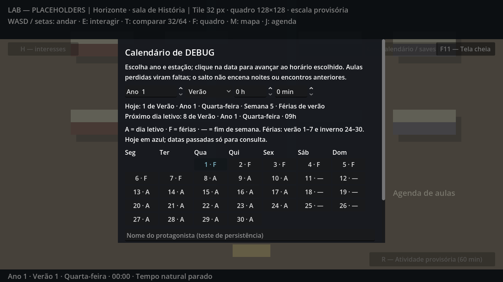
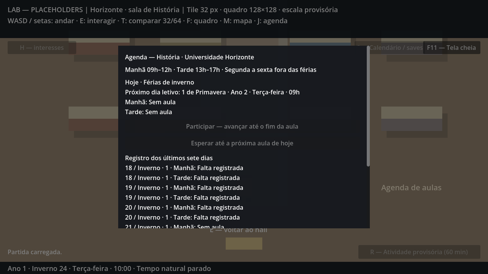
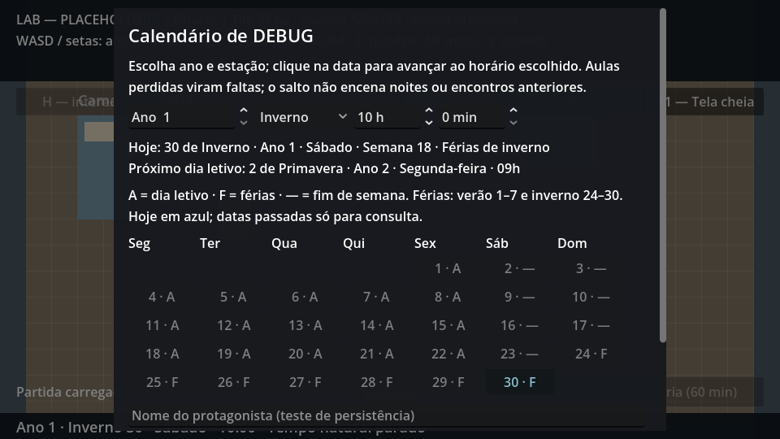

# P3-01 — Calendário completo e férias

Auditoria em 16/10/2026, Godot 4.7.2 oficial. A contagem absoluta de minutos, viradas de estação/ano, semana contínua e bloqueio acadêmico nas férias já existiam. Esta entrega centraliza a definição de dia letivo e torna as regras visíveis e verificáveis, sem outro manager ou esquema de save.

## Regras conferidas

| Regra do GDD §5 | Resultado |
|---|---|
| Estações | Primavera → verão → outono → inverno; 30 dias cada |
| Ano | 120 dias; inverno 30 → primavera 1 do ano seguinte |
| Semana | Segunda a domingo; dia e número da semana não reiniciam na estação/ano |
| Verão | Dias 1–7 inclusive; 7 dias corridos, mesmo quando há fim de semana |
| Inverno | Dias 24–30 inclusive; 7 dias corridos |
| Horizonte | Segunda a sexta fora das férias; 09h–12h e 13h–17h autorizados nesta etapa |
| Retorno | Primeiro dia útil depois do intervalo; pode ultrapassar primavera 1 |
| Frequência | Férias/fins de semana são `no_class`, nunca ausência; presença exige turno letivo |
| Relógio e sono | Consulta não avança; atividades/sono conservam eventos intermediários e mudança de data |
| Persistência | Data, férias e retorno derivados de minutos/origem semanal; esquema 3 sem novos flags |

O início do ano 1 em segunda-feira permanece **[HIPÓTESE TÉCNICA]**. `weekday_offset` 0–6 é preservado no save; não há escolha de origem semanal adicionada ao fluxo do jogador. Nenhuma data de feriado/festival, duração de semestre ou período extra de férias foi inventado.

## Implementação e consulta

- `scripts/core/time_manager.gd`: intervalos canônicos, `day_info(absolute_day, offset)` puro e busca inclusiva `next_teaching_day`. O contrato anterior de `calendar_at` continua igual.
- `scripts/core/academic_schedule.gd`: conserva a API `teaching_day`, delegando à regra central. A rotina mínima da colega e validação de presença/encontros já usam essa API.
- `scripts/ui/calendar_debug_panel.gd`: calendário de 30 datas alinhadas por origem/ano/estação, A/F/— e legenda, detalhes por tooltip, hoje em azul, número da semana e próximo dia letivo quando sem aula. Datas passadas continuam consultáveis com salto desabilitado; ano até 9999. Horas/minutos identificados.
- `scripts/ui/academic_panel.gd`: mostra o motivo de não haver aula e data/dia da semana do retorno. Ambos os painéis reabrem no topo e têm fundo opaco para leitura.
- `localization/lab.csv` e tradução gerada: textos por chaves; somente pt_BR está traduzido nesta etapa.

F5 inicia a cena; C consulta o calendário, J a agenda. Em C, selecione verão e confira 1–7 marcados F; inverno tem 24–30. Clicar avança para o futuro, mas não encena noites/encontros intermediários. As aulas letivas perdidas continuam derivadas como faltas pelo cursor acadêmico existente, sem gerar linhas por dia/ano. Consultar outras estações/anos não avança nem salva. Nome/auto/load ficam abaixo do calendário, acessíveis pela rolagem; Esc fecha a consulta.

## Testes reproduzíveis

```powershell
godot --headless --path . --editor --import --quit
godot --headless --path . --script res://tests/calendar_vacations_test.gd
godot --headless --path . --script res://tests/time_manager_test.gd
godot --headless --path . --script res://tests/academic_schedule_test.gd
godot --headless --path . --script res://tests/sleep_save_test.gd
godot --headless --path . --script res://tests/classmate_encounter_test.gd
godot --headless --path . --script res://tests/day_one_flow_test.gd
```

Nesta máquina, substitua `godot` pelo binário em `.tools/godot-4.7.2/Godot_v4.7.2-stable_win64_console.exe`. Para três capturas do calendário/agenda, execute o runner de calendário sem `--headless` e com `-- --capture`. Todos os runners usam somente `user://test_runs/`; não tocam nos slots reais.

O runner novo confere **5.880 datas**: ciclo completo de 840 dias (7 anos) para cada uma das 7 origens semanais, com contadores independentes das fórmulas de produção. Os resultados diários são agrupados por ano/origem em asserções; não são 5.880 asserções individuais. Confere exatamente 14 datas de férias por ano, fins de semana sobrepostos, retorno, alinhamento dos 28 grids do ano 2 e consulta do ano 9999.

A integração usa entrada de mouse real na data/aula/sono, snapshots, load com fade, professor após férias, ausência de rotina da colega nas férias, histórico distinguindo falta de dia sem aula e arquivos reais isolados. Forja presença/encontro em férias e verifica rejeição pelo validador. Atividade cruza meia-noite minuto a minuto; sono real passa inverno 30 → primavera 1 e primavera 30 → verão 1. Não se apresenta a preparação por fixtures do relógio como caminhada contínua; o runner separado do Dia 1 conserva os dois percursos caminhados.

## Evidências e limites

Execução final: **590 verificações, zero falhas**. Calendário renderizado: **223**, incluindo três capturas (220 sem capturas); relógio: **41**; agenda: **58**; sono/save: **51**; colega: **80**; Dia 1 contínuo: **137**. Não somar novamente variantes/repetições do mesmo runner. Importação/editor sem erros de script. No teste de recuperação de save do Dia 1, os erros de criação de diretório são intencionais; não houve erro de script ou falha de asserção. Logs locais ignorados em `test-results/p301-*.log`.







Sem playtest humano. Calendário ainda integra o painel de teste C; celular/calendário pessoal com compromissos conhecidos e UI final ficam para etapas posteriores. Origem semanal inicial, nome/símbolo da moeda e mesada continuam pendentes. P3-02 é a próxima tarefa; nenhum sistema econômico foi adicionado aqui.
