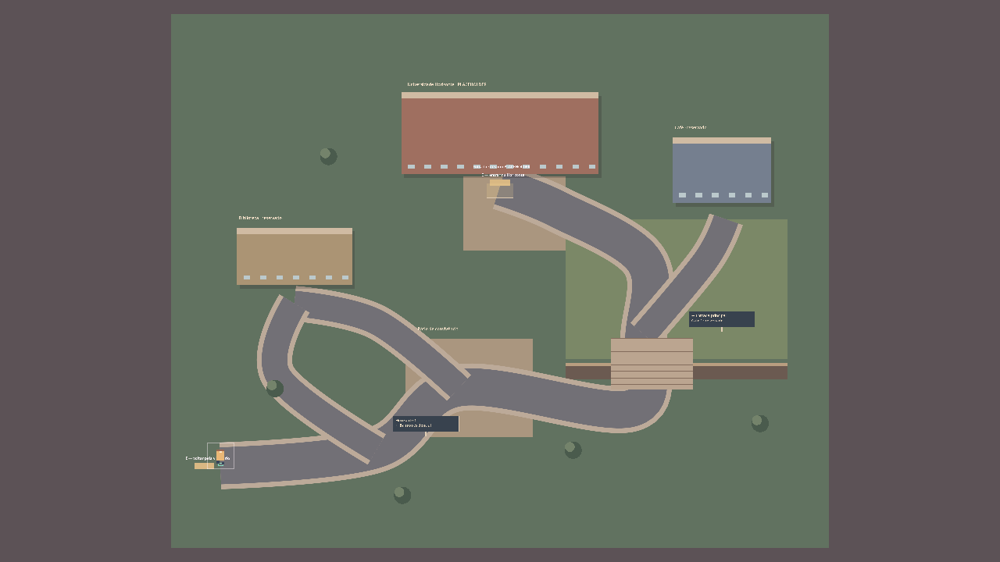

# Esqueleto urbano e universidade — P2-02

O criador pediu a substituição das duas áreas pequenas e do corredor reto por um esqueleto de cidade, com curvas, subidas/descidas, acessos futuros e fade. Esta ampliação acompanha P2-02; não autoriza implementar sistemas acadêmicos/hobbies/lojas completos.

## Organização proposta

- **Bairro:** núcleo de casas ao norte/oeste; rua local passando pela praça; cruzamento com ramificação costeira, escola e comércio; circuito secundário contornando a praça; saída para o rio ao sul/leste.
- **Via do rio:** chegada pelo sudoeste; rua curva cruza a ponte; subida por uma passagem entre taludes; caminho sinuoso no patamar alto até o acesso nordeste do campus. Ramais terminam em reservas para fliperama, skate e floresta.
- **Campus:** caminho pelo pátio, rampa e entrada principal; biblioteca/café reservados e circuito alternativo de circulação.
- **Hall:** corredor com área de convivência, guia placeholder e acesso à História à direita/acima.
- **Sala:** carteiras em filas, corredor central navegável e ponto de aula provisório. Sem professor definitivo, horário automático, perguntas ou frequência.

Os lugares reservados são hipóteses espaciais. A posição da escola, comércio e hobbies ainda não é cânone. O rio/taludes têm colisão; ponte/rampas são aberturas caminháveis. Não há pulo, física Z, velocidade especial de subida ou sistema de fadiga. Árvores são marcadores decorativos sem colisão nesta etapa.

## Referências consultadas e interpretação

- [Pelican Town — wiki oficial de Stardew Valley](https://wiki.stardewvalley.net/Pelican_Town): referência de concentração de destinos, vias reconhecíveis e conexão entre áreas. A combinação de praça, moradias e caminhos desta proposta é interpretação própria, sem copiar o mapa.
- [Village — Minecraft](https://www.minecraft.net/pt-br/article/village): referência visual de agrupamentos de edifícios ligados por caminhos e variação de ambiente. A geometria foi desenhada manualmente, sem geração de vilas ou importação de assets.
- [Create a World — The Sims 3](https://www.thesims3.com/content/global/downloads/caw/help_en.pdf): a orientação sobre organizar bairros apareceu na busca oficial; o PDF não pôde ser aberto pelo serviço de navegação. A setorização foi tratada como inspiração geral, não como reprodução de um layout verificado.
- [Arcadia Bay Collection — Square Enix](https://www.square-enix-games.com/en_US/home/life-strange-arcadia-bay-collection-comes-nintendo-switch-27-september): contexto da referência Life is Strange indicada pelo criador. A ideia de cidade costeira/campus com marcos foi interpretada para Fliegen; não se reproduz a planta de Arcadia Bay.
- **Harvest Moon:** referência estrutural indicada pelo criador e já presente no GDD para localidades conectadas e entradas de áreas. Nenhuma planta/asset específico foi copiado nesta entrega.

## Onde editar

`data/world/regions.json` concentra limites, ruas, lotes, terraços, taludes, rampas, água, ponte, decoração, labels por chave, placas de cruzamento, portas/spawns e posições do guia/destino/ponto de aula. `scripts/world/world_layouts.gd` converte pontos/retângulos e constrói curvas suaves; `city_area.gd` desenha placeholders e cria colisões/interações. Cenas `.tscn` escolhem a região. Reinicie o jogo após editar os dados.

As reservas terminam em fachadas ou áreas marcadas; novos locais podem ganhar portas/cenas sem reescrever o percurso. Não criar automaticamente um sistema novo só porque existe um lote reservado. Tiles/arte poderão substituir o renderer geométrico depois que a planta for aprovada.

## Transições e compatibilidade

`SceneFade` cobre todo o viewport em camada 100: fade-out, um frame preto, troca, atualização de câmera e fade-in. O controlador do laboratório congela ticks/controles durante a operação. E nas passagens, carregamento e retorno obrigatório usam esse fluxo. `change_area()` continua como operação imediata interna para inicialização e preparação de testes; jogadores usam as transições animadas.

Saves versão 1 são validados com os limites antigos antes de migrar. Áreas externas mudaram de geometria, então o personagem aparece na entrada segura da mesma região. No quarto, sua posição é conservada. Nenhum arquivo é regravado só por carregar. Esquema 2 aceita hall/sala e preserva os números com [JSON.stringify(full_precision)](https://docs.godotengine.org/en/stable/classes/class_json.html#class-json-method-stringify). Slots/preferência continuam separados.

## Capturas da engine

As visões gerais abaixo usam uma câmera de inspeção **somente no runner**; o jogo conserva zoom 1. Não são tiles finais ou imagens geradas como assets.

[Escala do bairro](screenshots/city_residential.png) · [Ponte](screenshots/city_bridge.png) · [Rampa](screenshots/city_ramp.png) · [Entrada da Horizonte](screenshots/city_campus.png) · [Hall](screenshots/city_hall.png) · [Sala de História](screenshots/city_classroom.png) · [Frame preto do fade](screenshots/city_fade_black.png)

Limites, verificações e medição real no registro mais recente de `docs/decisions.md`. Sem playtest humano; precisão de layout, arte e distribuição final de locais permanecem pendentes.
