# Primeira sessão técnica — 12/10/2026

## Escopo e ordem

Registro da primeira entrega: **primeira sessão técnica da seção 15 do GDD**, conforme a prioridade do AGENTS.md. Apenas o laboratório de escala, movimento e quarto↔rua. A tarefa atual P1-06 está registrada ao final deste documento.

| Roadmap | Estado nesta entrega |
|---|---|
| P0-01 | Projeto próprio e Git inicializados; Godot 4.5 executada |
| P0-02 | GDD/AGENTS preservados; README e gitignore adicionados/complementados |
| P0-03 | **[PENDENTE]** Nenhum caminho/recurso de Drowned foi disponibilizado; nenhuma auditoria nem reutilização presumida |
| P0-04 | Laboratório com quadro 128×128, porta, cama, mesa e fachada; alternância 32/64 |
| P0-05 | Comparação visual registrada; 32 escolhido somente como padrão técnico provisório |
| P1-01 | Movimento 8 direções, animações/idle 4 direções, diagonal normalizada |
| P1-02 | Mapas de teste quarto/rua e porta interativa com marcadores de entrada |

P0-03 não impede a seção 15: o GDD condiciona a inspeção de Drowned ao acesso. Nenhum arquivo daquele projeto foi lido ou alterado.

## Hipóteses técnicas, sem alteração do cânone

- **[PROPOSTA]** Viewport 960×540, câmera sem suavização e zoom 1; filtro nearest. Valores ajustáveis após playtest.
- **[PROPOSTA]** Tile padrão 32 px. Com o mesmo corpo placeholder, cama de 64×128 e porta de 64 px têm proporções mais compactas; em 64, a cama passa a 128×256 e a porta a 128 px. A comparação permanece acessível com T; não há produção de tiles finais.
- **[PENDENTE]** Aprovação criativa do tile e câmera. Os screenshots validam legibilidade técnica; não substituem playtest de conforto pelo criador.
- **[PROPOSTA]** Velocidade 180 px/s, corpo desenhado com 40×56 e pés, dentro de quadro 128×128; colisão 24×14 junto aos pés. Quadro não é tamanho do corpo.
- **[PROPOSTA]** Empates diagonais usam orientação horizontal. Parado, retém a última orientação.
- **[PROPOSTA]** Interação por E dentro da área de porta. A transição ocorre diferida, fora da atualização física; um personagem e uma área ativos, sem manager global prematuro.
- **[PROPOSTA]** T reposiciona o jogador no marcador seguro para evitar sobreposição após aumentar a mobília.
- **[PENDENTE]** Arte, nomes, disposição definitiva de casa/rua, localização completa en/es. Nada no mapa de teste determina geografia canônica.

## Capturas da engine

As quatro imagens foram renderizadas pela Godot 4.5 e inspecionadas visualmente. Personagem conserva a escala ao alternar o tile.

| Quarto 32 | Quarto 64 |
|---|---|
|  |  |

| Rua 32 | Rua 64 |
|---|---|
|  |  |

## Resultado da validação

Engine: `4.5.stable.official.876b29033`. Importação no editor headless; runner com física real; renderização OpenGL para screenshots. Logs locais em `test-results/`, ignorados pelo Git.

O runner cobre movimento/idle, dimensões dos quadros, tradução, colisões de parede/cama/mesa, portas acessíveis caminhando, recusa de interação distante, seis ciclos ida/volta com spawn correto em 32 e 64 e apenas uma área ativa. **60 verificações headless; mais 4 capturas no modo renderizado.** Não foi feito playtest humano nem validação de arte final.

Problema corrigido na inspeção: HUD encobria os objetos no enquadramento inicial; cama, mesa e fachada foram deslocadas para ficarem visíveis. O runner aguarda a sincronização de overlaps do servidor físico antes de interagir.

## Próxima tarefa sugerida

Após a primeira sessão, foi sugerida **P1-03 — TimeManager**, executada na entrega abaixo.

---

## P1-03 — relógio externo — 12/10/2026

**Escopo autorizado:** TimeManager com 60 segundos reais por hora do jogo e testes de minutos, meia-noite, estação/ano e dias da semana. Não foram adicionadas atividades com duração, férias, agendas, sono ou saves.

### Implementação e hipóteses

- `scripts/core/time_manager.gd`: nó reutilizável com minutos absolutos; não usa o relógio/data do sistema para definir o calendário. O laboratório conserva uma única instância nas trocas de mapa, sem Autoload nesta etapa.
- Um segundo de `_process(delta)` equivale a um minuto. Frações são acumuladas; cada minuto intermediário emite `minute_changed`, e cada meia-noite emite `day_changed`, nessa ordem. A tolerância numérica de 1e-9 s evita perder um minuto ao somar frames de 1/60 s.
- Calendário derivado: quatro estações de 30 dias; 120 dias por ano; dias da semana e número da semana continuam entre estações/anos. Sem lógica de férias/compromissos (P3-01).
- **[PROPOSTA]** Origem do laboratório: primavera 1, ano 1, 06h. **[PENDENTE]** Dia da semana canônico inicial. `weekday_offset` vai de 0 (segunda) a 6 (domingo), com 0 como padrão técnico provisório.
- A rua ativa o relógio; o quarto não o ativa. Essa conexão mínima é necessária para não avançar tempo natural em interiores contra o GDD. P1-04 continua como tarefa própria para consolidar e verificar a pausa, preservação de frações e transições repetidas; não foi criado sistema de UI/cutscene ou atividades.
- O nó usa o modo pausable padrão da Godot. UI de pausa ainda não existe.
- Label no rodapé usa chaves traduzíveis para data/hora, estações, dias da semana e estado do relógio. Foi regenerado `lab.pt_BR.translation` com a Godot 4.5.

### Como testar

Abra o projeto na Godot 4.5 e execute F5. O rodapé começa em 06:00; saia pela porta com E e observe o minuto mudar a cada segundo. Voltar ao quarto preserva a data/hora, com tempo natural desativado. Os demais controles do laboratório continuam disponíveis.

Runners reproduzíveis e opções de medição/captura estão no README. `time_manager_test.gd` executa testes determinísticos pela própria Godot e, com `--realtime`, mede também um minuto real em execução externa. Os testes chamam o mesmo callback de produção; não existe API de atividade com duração nesta entrega.

### Validações executadas

- Godot `4.5.stable.official.876b29033`: importação/editor headless sem erros de script ou recurso.
- **41 verificações determinísticas do relógio, zero falhas**, incluindo eventos cronológicos e integração com HUD/transições.
- Medição na engine renderizada: **60,028 segundos reais → +60 minutos do jogo**, sem aceleração artificial. A captura também passou; execução completa: **43 verificações, zero falhas**.
- Regressão do laboratório: **60 verificações de movimento, colisões e portas, zero falhas**.
- Captura abaixo inspecionada visualmente: rodapé legível, sem encobrir os controles. A captura mostra 08h porque o runner avançou uma hora deterministicamente antes de medir a hora em tempo real.


Limitações desta tarefa: sem playtest humano, menu de pausa, atividades com duração ou sono compulsório. O limite das 04h continua fora desta entrega, conforme P1-07. A origem do dia da semana continua **[PENDENTE]**.

### Próxima tarefa

**P1-04 — consolidar e validar pausa temporal em interiores.** P1-05 adicionará atividades com duração; P1-07 fará o limite de sono às 04h.

---

## P1-04 — pausa temporal em interiores — 12/10/2026

**Critério de aceite:** o relógio natural para ao entrar e volta ao sair, preservando data/hora. A ligação `time_manager.running = area.exterior` já havia sido incluída em P1-03 para respeitar o GDD. A validação desta tarefa confirmou esse comportamento sem exigir alteração do código de produção.

### Alterações e cobertura

- `tests/interior_time_test.gd`: runner dedicado na Godot 4.5, com relógio/cenas/portas reais do laboratório.
- Congelamento de 60 segundos simulados no quarto, sem eventos de minuto ou dia; jogador continua andando com o SceneTree ativo.
- Entrada/saída pelo caminho de interação E e overlap da porta; vinte ciclos adicionais de troca de mapa, preservando a instância do relógio e apenas uma área ativa.
- Frações verificadas por comportamento observável: 0,75 s fora + espera dentro + 0,25 s fora = exatamente um minuto; vinte ciclos com 0,1 s fora cada = dois minutos, sem duplicação/perda.
- Às 23:59, esperar dentro conserva a data e não emite meia-noite; ao sair e completar a fração externa restante, emite uma única mudança de dia.
- HUD conserva a hora e indica tempo parado/correndo conforme a área.
- Medição com ticks automáticos em uma cena nova: movimento continua durante espera real dentro; depois a porta leva à rua e o relógio volta a avançar. A opção `--realtime` usa contador monotônico para garantir pelo menos 60 segundos reais; execução padrão usa uma espera de 2 segundos.
- README atualizado com os comandos e o próximo passo. Nenhuma nova decisão de cânone.

### Como executar

Na Godot 4.5, F5. Espere/caminhe no quarto: a hora permanece igual. Use E na porta para sair, observe os minutos avançarem, volte e confira o congelamento. Automação:

```powershell
& '.\.tools\godot-4.5\Godot_v4.5-stable_win64_console.exe' --headless --path . --script res://tests/interior_time_test.gd
& '.\.tools\godot-4.5\Godot_v4.5-stable_win64_console.exe' --headless --path . --script res://tests/interior_time_test.gd -- --realtime
```

### Limitações e próxima tarefa

**Validações executadas:** Godot `4.5.stable.official.876b29033`, importação/editor headless sem erros. Runner de interiores: **42 verificações, zero falhas**, incluindo **60,069 segundos reais dentro do quarto → +0 minutos**, movimento ativo e retomada automática na rua após a porta. Regressões: **41 verificações do TimeManager** e **60 do laboratório**, todas sem falhas. Logs locais em `test-results/interior-*.log` (ignorados pelo Git).

Validação automatizada em headless, sem playtest humano nesta entrega. O congelamento aplica-se ao tempo natural, não ao SceneTree. Atividades com duração, diálogos, menu de pausa, sono e saves continuam nas tarefas correspondentes. Dia da semana inicial e escala visual seguem **[PENDENTE]** conforme as notas anteriores.

**P1-05 — ações com duração explícita:** uma atividade de 60 minutos deve avançar exatamente 60 minutos mesmo dentro do quarto, respeitando a ordem dos eventos intermediários.

---

## P1-05 — ações com duração explícita — 12/10/2026

**Critério de aceite:** uma ação de 60 minutos avança exatamente 60 minutos mesmo em interior. Escopo limitado à API de tempo, recurso de atividade e demonstração no laboratório.

### Arquivos e comportamento

- `scripts/core/time_manager.gd`: `can_advance_minutes()` permite consultar a disponibilidade; `advance_minutes()` retorna sucesso/recusa. O avanço explícito funciona independentemente de `running` e não altera a fração acumulada dos ticks externos.
- Avanços naturais e explícitos compartilham a emissão cronológica: cada minuto atualiza o estado antes de emitir `minute_changed`; meia-noite emite `day_changed` depois do minuto correspondente. Callbacks não podem iniciar outro avanço enquanto a sequência está em andamento.
- `scripts/activities/timed_action.gd` e `data/activities/lab_activity.tres`: recurso reutilizável com chave traduzível e duração em minutos. A atividade de laboratório é um placeholder genérico de 60 minutos, sem definir hobby, narrativa ou recompensa.
- `scripts/lab/scale_lab.gd`, `scenes/lab/scale_lab.tscn` e `localization/lab.csv`/`lab.pt_BR.translation`: tecla R e botão executam a mesma atividade, com label de resultado e relógio atualizado. Repetição automática da tecla é ignorada.
- `tests/timed_action_test.gd`: valida API e integração com cena real. README atualizado com comandos e próximo passo.

### Hipóteses e limite das 04h

**[PROPOSTA]** Seguindo a preferência provisória da seção 5.4 do GDD, a validação impede iniciar uma ação que terminaria às 04h ou depois, sem alterar tempo nem emitir eventos. Terminar às 03:59 é permitido; terminar exatamente às 04h é recusado nesta implementação conservadora. Duração zero/negativa também é recusada.

**[PENDENTE]** UX definitiva para impedir, interromper ou truncar ações no limite. P1-07 resolverá sono, retorno para casa e despertador. O relógio natural ainda pode atingir/passar das 04h; esta etapa apenas impede que um avanço explícito salte o próximo limite. Não existe estado de sono nesta entrega.

### Como executar e validações

Na Godot 4.5, execute F5 e pressione R ou clique no botão: no quarto, 06:00 vira 07:00 instantaneamente, com feedback “Atividade concluída: +60 min.”. Espere/caminhe: o tempo natural permanece parado. Na rua, a atividade também avança 60 minutos e os ticks naturais continuam.

Godot `4.5.stable.official.876b29033`: importação no editor headless sem erros de script/recurso. **34 verificações da atividade, zero falhas**: duração exata, frações, meia-noite/ano, eventos intermediários, recusa atômica no limite das 04h, reentrância, R/botão/HUD. Execução renderizada com captura: **35 verificações, zero falhas**. Regressões: **41 verificações do relógio**, **42 de interiores** e **60 do laboratório**, todas sem falhas. O teste de interiores desta etapa mediu **2,073 segundos reais → +0 minutos**, com movimento ativo e retomada na rua; a medição de 60 segundos da etapa anterior não foi repetida.

Captura renderizada pela Godot e inspecionada visualmente: botão, feedback e rodapé legíveis. Logs em `test-results/action-*.log`, ignorados pelo Git. Comandos reproduzíveis no README; não foi realizado playtest humano.


### Próxima tarefa

**P1-06 — sistema mínimo de diálogo/interação:** conversar sem consumir tempo por padrão. Sono e hobbies completos continuam nas tarefas correspondentes; escala, dia da semana inicial e localização en/es permanecem **[PENDENTE]**.

---

## P1-06 — diálogo/interação mínimos — 12/10/2026

**Critério de aceite:** conversar não consome tempo por padrão. Implementação limitada a falas lineares reutilizáveis, um NPC placeholder em cada mapa e integração com relógio/controles existentes.

### Arquivos e comportamento

- `scripts/dialogue/dialogue_data.gd` e `data/dialogues/lab_conversation.tres`: recurso com chave de identificação do interlocutor e sequência de chaves traduzíveis. Duas falas técnicas, sem determinar elenco ou fatos narrativos canônicos.
- `scripts/dialogue/dialogue_panel.gd` e `scenes/ui/dialogue_panel.tscn`: painel reutilizável com eventos `opened`/`closed`, avanço por E/Enter/botão e cancelamento por Esc/botão. Dados vazios são recusados antes de bloquear controles; uma conversa ativa não pode ser substituída.
- `scripts/world/dialogue_npc.gd` e `scenes/world/dialogue_npc.tscn`: quadrado azul provisório com área de proximidade e evento de diálogo. Instâncias em `room.tscn` e `street.tscn`; sem agenda, relações ou identidade de um NPC do elenco.
- `scripts/world/door.gd`/`door.tscn` e `scripts/lab/scale_lab.gd`: porta e NPC usam o grupo `interactables`, com alvo próximo selecionado pela menor distância dentro da área atual. Labels usam a chave da interação correspondente. A interação E continua funcionando nas portas.
- `scripts/player/player.gd`: controle de movimento pode ser bloqueado durante a conversa; velocidade é zerada e animação fica idle. Não pausa o SceneTree.
- `scenes/lab/scale_lab.tscn`, `localization/lab.csv`/`lab.pt_BR.translation`: painel, falas, botões e labels traduzíveis; README e este registro atualizados.
- `tests/dialogue_test.gd` e `docs/screenshots/dialogue_*.png`: testes e capturas reproduzíveis.

### Tempo e hipóteses técnicas

Durante a conversa, o laboratório desativa os ticks naturais sem alterar minutos nem a fração externa. Ao fechar, consulta a área atual: interior continua congelado; rua retoma. Nenhum caminho do diálogo chama `advance_minutes()`. A tecla que fecha o painel é consumida, evitando reabrir a conversa ou acionar uma porta no mesmo evento.

**[PROPOSTA]** Enquanto o painel está ativo, bloquear movimento, portas, atividade e controles de comparação do laboratório. Teclas E/Enter/Esc e caixa de falas sem retratos são UX técnica provisória. Ações programáticas de troca de mapa encerram a conversa com segurança e aplicam o estado do novo mapa. **[PENDENTE]** Conteúdo final, apresentação e escolhas/ramificações. Não foram adicionados managers globais, sistema de relações ou diário.

### Como executar e validar

Na Godot 4.5, F5. Caminhe até o quadrado azul à esquerda, espere aparecer “E — conversar” e use E. Avance com E/Enter/botão; feche com Esc/botão. Confira o horário antes/depois. Repita na rua: o rodapé indica tempo natural parado durante a conversa e volta a “Tempo externo” ao fechar.

Runner: `godot --headless --path . --script res://tests/dialogue_test.gd`. Para capturas, retire `--headless` e acrescente `-- --capture`. A opção `-- --realtime` mede 60 segundos reais; nesta etapa foi executada a medição curta padrão.

Godot `4.5.stable.official.876b29033`: importação/editor headless sem erros. **30 verificações de diálogo, zero falhas**, com proximidade física, propagação real de teclado, cliques na GUI, avanço/cancelamento, bloqueios, frações, troca programática de mapa, 32/64 e retomada. Medição final headless: **2,004 segundos reais de conversa na rua → +0 minutos**, com movimento bloqueado; ticks automáticos e movimento retomaram ao fechar. Execução renderizada: **32 verificações, zero falhas**, incluindo as duas capturas. Regressões: **60 do laboratório, 41 do relógio, 42 de interiores e 34 de atividades**, todas sem falhas.

Os cliques passaram na execução renderizada; para o headless, o runner injeta eventos de mouse em coordenadas locais do viewport, evitando a transformação de coordenadas da janela. Capturas renderizadas pela engine e inspecionadas visualmente. Logs locais em `test-results/dialogue-*.log`, ignorados pelo Git. Sem playtest humano.


### Próxima tarefa

**P1-07 — sono, despertador e limite das 04h**, incluindo casa/fora de casa e despertar às 12h do mesmo dia quando fora. Permanecem as pendências de escala, dia da semana e localização, e a recusa provisória de ações da P1-05.

---

## P1-07 + P1-08 — sono, salvamentos e laboratórios — 12/10/2026

**Escopo autorizado pelo criador:** P1-07 (sono/despertador/04h), P1-08 (save manual e auto), desenvolvimento em Godot 4.7, tela cheia preservando escala, calendário clicável para debug, filtros sazonais e percurso/pátio grande para medir a caminhada. Esta autorização amplia a regra usual de uma tarefa por entrega; o mapa da faculdade continua laboratório, sem implementar antecipadamente aulas, notas ou agendas.

### Arquivos e integração

- `scripts/core/time_manager.gd`: sinal do limite obrigatório, bloqueio de novos avanços enquanto há escolha de sono e API específica de avanço durante sono. A passagem de meia-noite permanece normal. O limite é habilitado explicitamente pelo laboratório, mantendo o relógio reutilizável sem impor sozinho política de cena.
- `scripts/core/sleep_manager.gd`: solicitação/cancelamento voluntário, contexto obrigatório dentro/fora, cálculo do próximo despertador e despertar às 12h fora. Não define consequências de fadiga.
- `scripts/core/save_manager.gd`: esquema JSON versão 1, validação antes de carregar, slots manual/auto separados, escrita temporária e renomeação, preferência de autosave separada e desligada por padrão.
- `scripts/ui/lab_panel.gd`, `sleep_panel.gd`, `calendar_debug_panel.gd`: modais com containers/scroll, escolha de sono/save, alarme, calendário de 30 dias, ano/estação/horário, preferência de auto e botões para carregar os dois arquivos.
- `scripts/world/sleep_bed.gd`, `scenes/world/sleep_bed.tscn`, `room.tscn` e `lab_area.gd`: cama interativa em 32/64 e marcador seguro para despertar.
- `scripts/world/travel_lab_area.gd`, `scenes/world/route.tscn`, `campus.tscn`, `street.tscn` e `door.gd`: percurso sinalizado 12.800×1.600 e pátio 2.400×1.600, colisões, transições em ambos os sentidos e câmera com limites próprios de cada mapa. Medição de percurso fica no laboratório.
- `scripts/lab/scale_lab.gd`, `scenes/lab/scale_lab.tscn`, `scripts/dialogue/dialogue_panel.gd`, `project.godot`: integração, pausa por modal, retorno ao quarto, persistência, HUD responsivo, câmera zoom 1, fullscreen inicial sem stretch e filtro do mundo em camada abaixo da interface.
- `scripts/world/dialogue_npc.gd`: label curta de placeholder para evitar sobreposição com o personagem ao despertar.
- `localization/lab.csv` e recursos de tradução/importação: novas chaves pt_BR. en/es continuam pendentes.
- `tests/sleep_save_test.gd`, `travel_display_test.gd`, `dialogue_test.gd`: cobertura nova e adaptação do runner de GUI aos IDs de dispositivos/viewport da Godot 4.7. README, AGENTS e `godot_4_7_migration.md` registram engine atual, comandos e próxima tarefa.

### Regras e persistência

Ticks externos param exatamente às 04h, mesmo com delta grande, retornam ao quarto se necessário e abrem a oferta de manual/sem manual. Esc não cancela sono obrigatório; movimento, atividade e portas permanecem bloqueados até a escolha. Fora: 04h → 12h no mesmo dia (480 minutos). Em casa: próximo despertador. O sono avança minutos e dias intermediários na ordem, sem disparar novamente o limite durante a própria noite.

O manual captura o estado **pré-sono** e restaura a oferta ao carregar, inclusive o contexto de sono obrigatório fora de casa. O auto, se habilitado, guarda ao acordar e nas transições. Iniciar a cena ou carregar um slot não sobrescreve o auto existente. Não há carregamento automático na inicialização. Erro de manual mantém a escolha aberta; o jogador pode tentar novamente ou dormir sem salvar.

`user://saves/slot_01/manual.json`, `auto.json` e `user://settings.json`. Esquema guarda relógio/fração/origem da semana, nome/posição/área, despertador/contexto e tile; sistemas ainda inexistentes não são antecipados no save. Arquivo inválido/corrompido preserva o estado corrente. O limite de posição valida os limites do mapa, não reconstitui toda a colisão de um arquivo editado manualmente. A renomeação é feita na mesma pasta; não foi simulado corte de energia nem falha física de disco.

### Hipóteses técnicas e pendências

**[PROPOSTA]** Alarme inicial 06h; alarme igual ao instante de deitar vale para o próximo dia. Fração natural reiniciada ao acordar, atraso excedente do frame interrompido às 04h descartado. Origem inicial da semana continua provisória/configurável. O campo de nome no debug testa persistência; não substitui o futuro fluxo de nova partida.

A recusa prévia de atividades que terminariam às 04h ou depois permanece da P1-05. **[PENDENTE]** UX definitiva para essas ações, consequências balanceadas de sono curto e caso de alarme exatamente às 04h (atualmente desperta no horário selecionado). Sem barra de energia ou crafting.

O calendário é debug de avanço: salta diretamente para a data/hora, sem simular noites/agenda/eventos intermediários. Destino exatamente às 04h dispara o sono obrigatório. Datas anteriores ficam desabilitadas. Os dias da semana seguem o contador absoluto, sem reiniciar em cada estação.

Filtros técnicos suaves: primavera rosa, verão azul, outono laranja, inverno branco; não definem direção de arte nem clima. Dimensões do percurso/pátio, velocidade e placas são dados de laboratório, não cânone geográfico. Contador de segundos inclui pausas durante a viagem; minutos de jogo seguem as regras de pausa. Reentrar pelo lado residencial reinicia a medição.

### Validação executada

Godot **4.7.2.stable.official.ed1daf0bf**, importação/editor headless sem erros. Documentação oficial das migrações 4.5→4.6→4.7 consultada; mudanças aplicáveis registradas em [godot_4_7_migration.md](godot_4_7_migration.md).

| Runner | Verificações | Resultado |
|---|---:|---|
| Sono/save | 51 | zero falhas |
| Laboratório | 60 | zero falhas |
| Relógio | 41 | zero falhas |
| Interiores | 42 | zero falhas |
| Atividades | 34 | zero falhas |
| Diálogo | 30 | zero falhas |
| Exibição/percurso padrão | 12 | zero falhas |

Total dos sete runners padrão: **270 verificações**. Sono/save usa interações reais de teclado e cliques de GUI, camas 32/64, sono obrigatório/voluntário, eventos intermediários, save pré-sono, retomar contexto obrigatório, preferências e arquivos independentes, arquivo inválido/corrompido, calendário/alinhamento da semana e filtros. Testes escrevem somente em diretórios isolados de `user://test_runs/`.

Ensaio adicional `travel_display_test.gd -- --walk`: **14 verificações, zero falhas**; percurso completo com física de colisão e ticks naturais, **12.351 px em 68,717 segundos reais → +68 minutos**. Porta distante alcançada caminhando e entrada/saída do pátio corretas. Essa variante inclui as verificações padrão; não somar suas contagens como testes independentes.

Execução renderizada `-- --capture`: **19 verificações, zero falhas**, sete PNGs gerados pela engine e inspecionados visualmente. Escala/HUD verificados em 960×540, 1366×768 e 1920×1080; viewport de tela cheia capturado nesta máquina: 1366×767. Corpo do protagonista conserva 40×56 pixels. Não foi realizado playtest humano nem conferência de todos os monitores/DPIs. Regressões usaram esperas reais curtas; não repetiram os ensaios históricos de 60 segundos. Logs locais ignorados pelo Git.


Filtros no mesmo enquadramento do pátio: [primavera](screenshots/season_0.png), [verão](screenshots/season_1.png), [outono](screenshots/season_2.png), [inverno](screenshots/season_3.png).

### Próxima tarefa

**P2-01 — trajeto residencial → Horizonte sinalizado**, consolidando o protótipo atual para chegar a pé à aula das 09h em ritmo viável. Nenhuma dimensão do laboratório foi promovida a cânone. P0-03/Drowned, origem da semana, conteúdo final, en/es e balanceamento permanecem pendentes.

---

## P2-01 — trajeto residencial → Horizonte sinalizado — 13/10/2026

**Critério:** chegar a pé para a referência de aula das 09h em ritmo viável. Esta entrega consolida o mapa grande solicitado na P1, preservando dimensões, velocidade e escala. Não implementa a sala de aula (P2-02), grade/frequência (P2-03), professor ou novos NPCs.

### Arquivos e comportamento

- `scripts/world/wayfinding_sign.gd` e `scenes/world/wayfinding_sign.tscn`: placa reutilizável com duas chaves traduzíveis, sem colisão de bloqueio. Instâncias na rua e no pátio; dezenove placas a cada 640 px no percurso, orientando Horizonte à direita e bairro à esquerda.
- `scripts/world/travel_lab_area.gd`: substitui a sinalização antiga desenhada diretamente pelo componente reutilizável. Rebuild de tiles não duplica placas. Dimensões 12.800×1.600 e 2.400×1.600 preservadas.
- `scripts/world/journey_destination.gd` e `scenes/world/journey_destination.tscn`: destino Area2D, evento de chegada apenas para o jogador e retângulo placeholder em frente à fachada, posição (1504,680). Não entra no prédio nem bloqueia a exploração.
- `scripts/world/walking_journey.gd`: medição diagnóstica desacoplada de cenas, com origem, segundos monotônicos, minutos do mundo, horário de chegada e margem até as 09h do dia da saída. Resultado estruturado em IDs/valores, traduzido apenas ao apresentar.
- `scripts/lab/scale_lab.gd`: começa ao sair do quarto, continua pela rua/percurso/pátio e termina ao tocar o destino. Entrada direta no percurso inicia ensaio identificado como parcial. Reentrar no destino não sobrescreve o resultado. Voltar ao quarto, saltar calendário, carregar ou usar T reinicia a medição; a medição não é persistida como estado de gameplay.
- `scenes/world/street.tscn` e `campus.tscn`: direções de ida/volta e marcador de chegada; caminhos existentes permanecem acessíveis em ambos os sentidos.
- `localization/lab.csv` e tradução pt_BR: novos textos por chave. `tests/signposted_journey_test.gd`: ida inteira e volta usando movimento/física e teclado E reais, pontualidade, atraso, resets, saves e escala. `tests/travel_display_test.gd`: entrar no pátio agora mantém a medição ativa até o prédio.
- README/AGENTS atualizados com controles, escopo e próxima tarefa. Capturas `docs/screenshots/signposted_*.png`. Fonte do cabeçalho reduzida para 16 em larguras abaixo de 1100, evitando quebra sobre os controles em 960×540; câmera e personagem continuam em escala 1.

### Como rodar

Godot 4.7, F5. Saia do quarto com E, siga a placa à direita da rua e use E na passagem. Continue para a direita no percurso, entre no pátio com E, siga à direita e depois para cima até o retângulo em frente à fachada. Confira no HUD o horário e a margem até as 09h. Volte para a esquerda seguindo as placas do bairro e, na rua, siga a indicação de casa e use E na porta.

Runner: `godot --headless --path . --script res://tests/signposted_journey_test.gd`. Padrão acelera relógio e física com `Engine.time_scale = 8` para repetir os trajetos. Acrescente `-- --walk` para a primeira ida na proporção real de produção; retorno e saída tardia continuam acelerados. Para cinco capturas, retire `--headless` e acrescente `-- --walk --capture`.

### Validações e limites

Godot **4.7.2.stable.official.ed1daf0bf**. Runner padrão: **59 verificações, zero falhas**, incluindo caminhada de ida/volta sem teletransportes, overlap físico nas quatro passagens, chegada antes das 09h, saída tardia sem bloqueios, alinhamento das placas, marcador do prédio, não duplicação do resultado, reinício por debug/load/T, tiles e saves em diretório isolado. O runner só reposiciona o personagem ao preparar capturas de enquadramento, após concluir a medição.

Regressões executadas nesta entrega: laboratório **60**, diálogo **30**, sono/save **51** e exibição/percurso **12**, todas sem falhas (**153 verificações**). O teste de exibição foi repetido depois do ajuste de fonte. As regressões históricas de relógio/atividades/interiores não foram repetidas porque seus módulos não foram alterados; resultados anteriores permanecem no registro da P1. Importação final e ensaio renderizado registrados abaixo.

**[PROPOSTA]** Placas a cada 640 px, seus tamanhos/posições, corredor reto e marcador são layout técnico para testar caminhada. Não promovem o mapa a cânone nem definem arte final. O retângulo de chegada termina o teste ao tocar sua área, sem exigir interação extra.

**[PENDENTE]** Layout final da cidade/campus, tile definitivo, arte de placas e possibilidade futura de transporte. Segundos decorridos incluem pausas e hesitações; minutos seguem as regras de relógio. Medição até as 09h é referência diária de laboratório, não afirma que há aula em fim de semana/férias nem registra presença/falta. O jogador pode chegar tarde e continuar explorando. Escala 128×128/zoom 1 e regras de sono/save preservadas; Drowned não foi alterado.

Importação/editor headless final sem erros. Ensaio renderizado na proporção real: **79,129 segundos da saída de casa até o ponto de entrada**, avanço de **79 minutos**, chegada **07:19**, **101 minutos de margem até 09h**. Distância percorrida pelo runner desde o spawn inicial do quarto: 14.300,4 px (inclui o trecho interior anterior ao início da medição externa). Cinco capturas e verificação adicional do cabeçalho 960×540: **65 verificações, zero falhas**. São variantes do mesmo runner, não somar a contagem de 65 à de 59 como testes independentes.

As imagens finais foram inspecionadas: cabeçalho em três linhas sem sobrepor os botões em 960×540, placa da entrada acima do rodapé, label do destino acima do personagem, placas de ida/volta legíveis. O ensaio real foi repetido após corrigir a sobreposição do cabeçalho e a posição da placa encontradas nas primeiras capturas. Sem playtest humano. Logs em `test-results/journey-*.log`, ignorados pelo Git. Nos outros trajetos do runner, a aceleração é somente do teste e é restaurada antes de encerrar; produção mantém a proporção canônica.


[Chegada em 960×540](screenshots/signposted_arrival_960.png) · [Placas no pátio](screenshots/signposted_campus.png)

### Próxima tarefa

**P2-02 — cena da universidade e sala de aula:** entrar, explorar, conversar e acessar o ponto de aula. Agenda acadêmica/frequência continua separada na P2-03. Não antecipar avaliação, elenco completo ou outros mapas nesta próxima etapa.

---

## P2-02 — universidade e esqueleto urbano — 13/10/2026

**Escopo autorizado:** próxima tarefa (universidade/sala) e reformulação explícita do mapeamento pelo criador: ruas curvas, subidas/descidas, acessos futuros, menor repetição de placas e fade-out/in. A geometria anterior da P2-01 foi substituída; suas capturas/medições permanecem registro histórico, não a planta vigente.

### Entrega e arquivos

- `data/world/regions.json`: bairro 3200×2400, via do rio 6000×3600, campus 3200×2600, hall 1600×1100 e sala 1400×1000. Quarto 960×640 preservado. Dados incluem vias principais/secundárias, curvas, lotes, praças, patamares/taludes/rampas, água/ponte, decoração, labels traduzíveis, portas/spawns, guia, destino e ponto de aula.
- `scripts/world/world_layouts.gd`: leitura/conversão central dos dados e curvas suaves. Os mesmos limites são consultados pelos saves. `city_area.gd`: desenho geométrico, colisões e instanciamento de componentes existentes. As cenas de rua/percurso/campus escolhem a região; novas cenas de hall/sala fazem o mesmo. O antigo `travel_lab_area.gd` foi removido.
- Bairro com circuito em volta da praça; campus com circuito de circulação. Dez ruas secundárias/alternativas somadas nas áreas externas, cada uma verificada fisicamente. Lotes reservados não ativam lojas/hobbies/futuras regiões.
- Placas nos cruzamentos (duas por área externa, uma no hall), sem sequência repetida por distância. Sinalização e portas continuam componentes reutilizáveis. Edifícios de tamanhos variados, sombras simples, árvores geométricas, praças e formas de terreno são placeholders, sem novos assets externos.
- `scripts/ui/scene_fade.gd`: fade-out, frame preto, troca de mapa, atualização da câmera e fade-in. `scripts/lab/scale_lab.gd`: valida destino antes do fade, bloqueia interações/movimento/ticks, preserva fração temporal e integra portas, carregamento e retorno do sono obrigatório. `change_area()` permanece operação imediata interna para inicialização/testes; interação de jogador usa o fluxo animado.
- `data/dialogues/university_guide.tres` e `lesson_placeholder.tres`: guia técnico e acesso à sala de História por chaves. `interaction_point.gd`/`.tscn`: ponto de aula que abre diálogo placeholder. `dialogue_npc.gd` aceita uma chave de marker para identificar o guia, sem definir professor/elenco final. Hall/sala são interiores navegáveis com relógio natural congelado.
- `scripts/core/save_manager.gd`: esquema 2 aceita novos interiores/limites. Migração valida o esquema 1 com limites antigos e reposiciona saves externos na entrada segura da mesma região; quarto conserva posição. Mantém nome, minutos/fração, origem da semana, alarme/contexto e tile. Não regrava o arquivo original durante carga. Novos JSONs usam precisão completa para frações.
- `tests/city_university_test.gd`: runner urbano/interiores/fade/migração. `signposted_journey_test.gd` passa a alias de compatibilidade do mesmo runner (não contar como suíte independente). `travel_display_test.gd` adapta limites e espera o fade; caminhada completa fica no novo runner. Demais runners aguardam transições quando aplicável e usam diretórios isolados, inclusive os testes legados, para proteger slots da partida.
- `localization/lab.csv` e tradução pt_BR, README/AGENTS e [city_layout.md](city_layout.md): instruções, hipóteses, referências e imagens. Sem mudanças no GDD histórico ou Drowned.

### Uso e limites

F5 na Godot 4.7. E sai do quarto; siga as ruas da praça até a saída ao sul/leste. Na via do rio, atravesse a ponte, siga a rampa ao norte e a rua sinuosa até o campus no nordeste. Pelo pátio/rampa chegue à fachada e use E para entrar no hall. Converse com o guia, siga o corredor à direita/acima e use E para entrar na História; o corredor central chega ao ponto de aula. E abre o diálogo provisório. Volte pelas mesmas passagens ou explore os circuitos/ramais.

**[PROPOSTA]** Distribuição de lotes/ruas e suas dimensões, posição da escola/comércio/hobbies, ponte/patamares, árvores e decoração são layout de teste. As referências solicitadas foram interpretadas para Fliegen; não se copiou planta/asset de outro jogo. Detalhes e fontes em `city_layout.md`.

Desnível é topografia 2D: terreno em patamares, taludes sólidos, passagens por rampa/escadaria. Não há eixo Z, pulo ou penalidade de velocidade/energia. Árvores são decoração sem colisão nesta fase. Terreno livre pode ser atravessado; somente edifícios, água/taludes e limites bloqueiam. As ruas secundárias terminam em reservas, sem novos mapas/sistemas completos. Grade/presença/notas não são implementadas; o ponto de aula indica conteúdo futuro. A referência das 09h continua diagnóstica, sem afirmar aula em fim de semana/férias.

Save antigo externo muda de posição pela reforma de geometria e informa a migração; nenhum arquivo é sobrescrito só ao carregar. O esquema atual guarda posição exata dentro dos limites, sem reconstruir colisão de arquivos editados manualmente. Precisão limitada já gravada por JSONs antigos não pode ser recuperada; a migração verifica fração com tolerância de 1e-6, e os novos saves verificam round-trip exato de `0.1234567890123456`. Slot manual/auto e preferência continuam independentes.

### Validações executadas

Godot **4.7.2.stable.official.ed1daf0bf**, importação/editor headless final sem erros. Os oito runners padrão passaram:

| Runner | Verificações | Resultado |
|---|---:|---|
| Cidade/universidade | 90 | zero falhas |
| Laboratório/movimento | 60 | zero falhas |
| Relógio | 41 | zero falhas |
| Interiores | 42 | zero falhas |
| Atividades | 34 | zero falhas |
| Diálogo | 30 | zero falhas |
| Sono/save | 51 | zero falhas |
| Exibição/transições | 12 | zero falhas |

**360 verificações padrão**, sem somar o alias. Novo runner percorre vias com física de colisão e E real; verifica ida/volta, barreiras de rio/talude fora das passagens, dez ramais/circuitos, fade por fase, clock/fração congelados durante fade, uma área ativa, guia, exploração e ponto de aula, save de interior, migração sem regravação, 04h na universidade/retorno às 12h e autosave desligado respeitado. A medição é feita antes dos fixtures de colisão/ramais; não há teletransporte no meio da ida/volta.

Ensaio renderizado `-- --walk --capture`: **100 verificações, zero falhas**, dez PNGs da engine inspecionados. Primeira ida na proporção real: **106,445 segundos**, **+105 minutos**, chegada **07:45**, **75 minutos de margem até 09h**. Segundos incluem fades e breves operações de captura; o relógio pausa durante fade. Retorno/fixtures acelerados com `Engine.time_scale = 6`, restaurado ao encerrar; o ensaio padrão acelerado não fornece medição real 1:1. A variante renderizada inclui o conjunto base de 90 e não deve ser somada como suíte independente.

As visões gerais usam câmera de inspeção apenas no teste. Gameplay conserva câmera zoom 1, corpo 40×56 e frame 128×128. Capturas mostram curvas, circuitos, ponte/rampa, interior/sala e frame completamente preto do fade. Regressão de exibição confere escala/HUD em 960×540, 1366×768 e 1920×1080. Não houve playtest humano nem simulação de corte de energia/falha física de disco. Logs `test-results/city-*.log` ignorados pelo Git; todas as suítes escrevem somente em `user://test_runs/`.


Demais imagens e referências em [city_layout.md](city_layout.md).

### Próxima tarefa

**P2-03 — agenda acadêmica mínima manhã/tarde**, avanço temporal de aulas e registro de presença/falta. Horários de encerramento matutino/almoço/tarde continuam provisórios no GDD. Tile/arte/layout final, conteúdo acadêmico e NPCs definitivos, transporte, origem da semana e en/es permanecem pendentes. Não implementar outras fases só porque existem reservas no mapa.


---

## P2-03 — cidade da imagem, agenda e frequência — 15/10/2026

### Escopo e decisões do criador

Solicitação explícita: remover o esqueleto urbano anterior, reconstruir o mapa da imagem com todos os pontos de interesse/estradas e executar P2-03, testar e publicar no GitHub. Esclarecimentos respondidos pelo criador: **reconstruir ampliado preservando proporções e escala do personagem**; **usar 09h–12h e 13h–17h nesta etapa**. O GDD histórico permanece intacto. Professor, avaliação, quiz e novos sistemas de lojas/hobbies não entram nesta entrega.

### Arquivos e comportamento

- `data/world/reference_city.json`: 22 pontos nomeados, 33 traçados de vias/caminhos/pontes e ferrovia, costa/rio e 50 pegadas de prédios (41 fachadas adicionais e nove edifícios de pontos de interesse). Coordenadas anotadas manualmente na imagem. Fator 6 uniforme, planta 9720×5826. `regions.json` substitui somente exteriores, conserva hall/sala, define três recortes sobrepostos e 14 ligações reversíveis. Quarto permanece igual.
- `ReferenceCity` centraliza conversões, água, corredores de travessia e colisões. `ReferenceRenderer` desenha curvas, casas/comércio, fontes, campos, parque, camping, farol, costa e porto como placeholders geométricos. A imagem original do criador foi copiada sem edição para `assets/world/fliegen_reference.png` e aparece **somente no painel M** com posição vermelha. A planta jogável não é a imagem ampliada como piso. Trees/props são decorativos; não há arte final/tilemap novo.
- `place_marker.gd` dá identificação externa aos 22 locais por chaves traduzíveis, sem ativar seus interiores/sistemas. Universidade mantém o hall/sala; ao disputar com o marcador informativo, a porta tem prioridade. Passagens alternativas têm círculos discretos e dica no HUD; preservam o fade e não repetem placas de texto pela cidade.
- `academic_schedule.gd` e `data/schedules/academic.json`: turnos aprovados, segunda a sexta fora das férias canônicas, espera explícita na sala e participação até o fim do turno com todos os eventos de minuto. Participação registra presença; turno encerrado sem participação registra falta. Permanecer no campus/sala não conta como participar.
- **[HIPÓTESE TÉCNICA]** Atrasado pode participar antes do fim; grava o instante de entrada. Penalidade, presença parcial, notas e conteúdo da aula são **[PENDENTE]**. Espera não pula aula em andamento, nem atravessa noites/04h. Férias são apenas o filtro necessário da agenda, sem antecipar o restante da P3.
- `academic_panel.gd`: J consulta hoje e últimos sete dias em qualquer área; esperar/participar é habilitado e revalidado somente na sala. E no ponto de aula abre o mesmo painel. Movimento/relógio natural ficam congelados em painéis. `city_map_panel.gd` / `city_map_view.gd` dão referência de posição sem teleporte.
- Save esquema **3**: intervalo acompanhado e presenças explícitas. Faltas são determinadas pelos turnos letivos encerrados sem presença dentro do intervalo persistido. Debug reconciliado sem iterar dia a dia, inclusive ano 9999. Relógio e intervalo restauram juntos no load. Auto opcional também grava após espera/participação. Manual/auto/preferências separados e oferta manual na cama preservados.
- Migração de **1/2** valida coordenadas com limites históricos antes de recolocar exteriores na entrada segura. Interiores inalterados preservam coordenadas. Registro começa na hora do save migrado, sem inventar faltas anteriores. Arquivo original não é alterado ao ler. Fração temporal, nome, origem semanal, tile e alarme continuam preservados.
- README/AGENTS atualizados; `docs/reference_city.md` documenta planta, todos os locais, coordenadas, controles e limites. `docs/city_layout.md` marcado como histórico da P2-02. Novos textos em pt_BR com chaves para tradução futura.

### Execução e validação

Godot **4.7.2.stable.official.ed1daf0bf**. Importação/editor headless final sem erros de script/recurso. Todas as partidas de teste usam `user://test_runs/` isolados; nenhum slot real foi modificado.

| Runner | Verificações finais | Resultado |
|---|---:|---|
| `city_university_test.gd` renderizado | 233 (inclui seis capturas) | zero falhas |
| `academic_schedule_test.gd` renderizado | 56 (inclui uma captura) | zero falhas |
| `scale_lab_test.gd` | 60 | zero falhas |
| `time_manager_test.gd` | 41 | zero falhas |
| `interior_time_test.gd` | 42 | zero falhas |
| `timed_action_test.gd` | 34 | zero falhas |
| `dialogue_test.gd` | 30 | zero falhas |
| `sleep_save_test.gd` | 51 | zero falhas |
| `travel_display_test.gd` | 12 | zero falhas |
| **Total, sem somar variantes repetidas** | **559** | **zero falhas** |

Urbano: conectividade dos 22 acessos com grade sobre os obstáculos, overlap/interação reais, consultas de forma física ao longo de todas as vias caminháveis (ferrovia decorativa), spawns livres, passagens principais e alternativas nas duas direções com posição correta, relógio/fração preservados, física de caminhada na ida principal, entrada/guia/sala/agenda, retorno e cobertura do fade. Consultas amostram o eixo das vias; não equivalem a varrer cada pixel da largura das ruas. Fixtures das alternativas posicionam o personagem junto às passagens; a medição principal usa movimento real entre os pontos de rua.

Durante a verificação apareceram fachadas sobre trechos anotados das vias; foram corrigidos trajetos/pegadas mantendo a organização da referência. O teste de aproximação de waypoint em velocidade normal foi ajustado para usar pressão de direção inteira, evitando que magnitudes de teste caíssem na zona morta do input antes de alcançar o alvo. Nenhuma velocidade/input de produção foi alterado.

Agenda: cliques reais nos botões, espera 06h→09h e 12h→13h, aula 09h→12h e chegada 13h20→17h, ordem dos minutos, evento de encerramento, não duplicação, ações remotas recusadas, aula em andamento não pulável por espera, faltas após debug/sono até meio-dia, fins de semana/férias, load manual/auto com rollback conjunto, arquivos independentes, validação de presença/futuro, migração 1/2 incluindo coordenadas da antiga rota longa, interiores preservados, originais intactos e salto para ano 9999 sem histórico expandido.

Ensaio renderizado **sem aceleração na ida**: **42,359796 s**, avanço de **39 minutos**, chegada **06h39**, **141 minutos antes das 09h**. Segundos incluem pausas de transição; o relógio fica congelado durante fade/carregamento. Logs: `test-results/reference-render.log` (medição normal), `reference-render-final.log` (capturas após refinamentos de rótulos/mapa), `academic-render.log`, `p203-*.log`. Logs ignorados pelo Git. O runner padrão usa aceleração 6× e sua duração de parede não descreve produção. Variantes compartilham verificações; não somar novamente seus totais.

Sete capturas finais renderizadas e inspecionadas: `reference_geometry_overview`, `reference_street`, `reference_route`, `reference_campus`, `reference_university`, `reference_overview`, `academic_agenda`. A visão geral usa zoom de inspeção somente no runner; jogo em zoom 1. Corrigida sobreposição de nome na entrada da universidade e ajustada altura da imagem no painel para deixar o botão de fechar visível. Sem playtest humano.

### Limites e próximo passo

Mapa mantém proporções/posições gerais da referência com anotações e formas aproximadas; não é reprodução pixel a pixel de fachadas/árvores. Colisões de água são uma malha aproximada com margem de travessia; árvores não colidem. Não há sistema de altura/Z, transporte, todos os interiores dos novos locais ou arte final. A distribuição nominal dos locais vem da imagem e não resolve o cânone definitivo. Sem energia/crafting. Drowned não foi modificado.

Próxima tarefa: **P2-04 — professor e primeira aula**, diálogo introdutório usando esta agenda, sem antecipar banco de questões ou avaliação.


---

## P2-04 — professor e apresentação da primeira aula — 15/10/2026

**Escopo autorizado:** professor placeholder e diálogo introdutório da primeira aula, usando a agenda já implementada; testes e publicação no GitHub. O GDD mantém nomes, aparências e biografias dos NPCs **[PENDENTE]**. As falas desta etapa são texto provisório de acolhida ao curso de História da Horizonte, sem definir identidade pessoal, disciplina específica ou avaliação.

### Arquivos e fluxo

- `data/dialogues/professor_greeting.tres` e `professor_introduction.tres`: recursos `DialogueData` por chaves traduzíveis. Conversa curta orienta o uso da agenda; apresentação tem quatro falas sobre acolhida, fontes, argumentos e o início do curso. `localization/lab.csv` e recurso pt_BR importado contêm os textos.
- `data/world/regions.json`: professor ao lado do ponto de aula, sem bloquear o corredor. `city_area.gd` lê chave de rótulo/dica e deslocamento opcional; `dialogue_npc.gd` reutiliza o quadrado genérico. Posição do rótulo ajustada após inspeção para não disputar com os botões do HUD. Dados do guia e dos NPCs anteriores preservados.
- `DialoguePanel.finished(was_completed)` diferencia avançar além da última fala de fechar/cancelar. `opened`/`closed` e os controles existentes continuam compatíveis; um diálogo inativo não emite outro encerramento. O sinal é genérico, sem conhecimento sobre professor ou agenda.
- `scale_lab.gd`: Participar na primeira aula elegível esconde a agenda e abre a apresentação. Tempo natural e movimento ficam bloqueados. Concluir a última fala usa a atividade acadêmica existente, avança minuto a minuto ao fim do turno, registra presença e a flag de conclusão, depois volta à agenda. Esc/Fechar volta à agenda sem presença, flag ou avanço temporal, inclusive se cancelar na última fala. Pode tentar novamente.
- Conversar informalmente com o professor não completa a apresentação nem registra frequência. Iniciar repetidamente, segurar E ou avançar depois de terminar não duplica a aula. Mudança interna de área/carregamento cancela a continuação pendente; transições/interações e debug são bloqueados enquanto o diálogo está ativo. Retorno de sono também limpa a continuação antes de fechar o painel.
- `academic_schedule.gd`: `professor_intro_seen` no estado acadêmico. Esquema **3** preservado, campo opcional validado como booleano e ausência interpretada como `false`. Saves anteriores da P2-03 mantêm posição e frequência, sem migração de coordenadas. Migrações 1/2 continuam iniciando estado acadêmico compatível. Auto opcional, após concluir a aula, contém frequência e conclusão juntos; manual anterior restaura a apresentação pendente. Não há save silencioso ao abrir/cancelar.
- `tests/professor_intro_test.gd`: fluxo específico com movimento/física, teclado, mouse, cancelamento, conclusão, persistência e compatibilidade. `tests/academic_schedule_test.gd` incorpora a apresentação na primeira participação; demais expectativas de horários/presença/falta preservadas. README, AGENTS e nota da planta atualizados.

**[HIPÓTESE TÉCNICA]** A apresentação aparece na primeira aula frequentada, em vez de exigir uma data fixa. Na rota esperada, é a manhã do primeiro dia; se o jogador faltar, pode conhecê-la à tarde ou em outro dia letivo. Atrasos seguem a regra provisória existente: pode participar até antes do encerramento; faltas anteriores não são apagadas. Professor fica estático na sala nesta etapa; sua rotina completa e as falas/identidade finais permanecem **[PENDENTE]**.

### Como experimentar

Godot 4.7, F5. Vá à sala de História. E perto do professor abre a conversa breve. E no ponto de aula ou J abre a agenda; espere até 09h e clique Participar. E/Enter/Continuar percorrem as quatro falas; concluir avança até 12h. Esc/Fechar cancela e permite tentar de novo. Depois de concluída, as próximas aulas usam o avanço normal sem repetir a apresentação. Para confirmar load, habilite auto no calendário ou salve manualmente na cama e retome a partida.

### Validação executada

Godot **4.7.2.stable.official.ed1daf0bf**. Importação/editor headless final sem erros. Todos os runners usam diretórios isolados `user://test_runs/`, sem tocar nos saves reais. Capturas renderizadas e inspecionadas em 1280×720; sem playtest humano.

| Runner | Verificações | Resultado |
|---|---:|---|
| Professor renderizado | 47 (inclui duas capturas) | zero falhas |
| Agenda acadêmica | 57 | zero falhas |
| Cidade/universidade | 227 | zero falhas |
| Escala/movimento | 60 | zero falhas |
| Relógio | 41 | zero falhas |
| Tempo em interiores | 42 | zero falhas |
| Ações temporizadas | 34 | zero falhas |
| Diálogo anterior | 30 | zero falhas |
| Sono/save/calendário | 51 | zero falhas |
| Resolução/percurso | 12 | zero falhas |
| **Total sem somar variantes repetidas** | **601** | **zero falhas** |

Professor: acesso físico ao NPC; saudação traduzida sem frequência; conclusão/cancelamento diferenciados; aula não avança antes de concluir; relógio/fração e controles; bloqueio de R/T/M/transição/debug; input repetido; Esc e mouse Fechar na última fala; load durante apresentação; cancelamento por troca interna de mapa; minutos 09h→12h em ordem; presença e flag no mesmo auto; auto separado do manual; segunda aula sem repetição; rollback manual; schema 3 sem flag; validação de flag inválida; primeira participação à tarde ou dia posterior preservando faltas; fim de semana/férias sem apresentação. Não somar novamente as 45 verificações da variante headless, contidas nas 47 renderizadas.

Comandos novos: `godot --headless --path . --script res://tests/professor_intro_test.gd`; para as capturas, retirar `--headless` e acrescentar `-- --capture`. Regressões conforme README. Logs locais em `test-results/p204-*.log`, ignorados pelo Git. A circulação urbana foi reexecutada com aceleração somente de teste; não foi repetida medição em velocidade normal, pois a planta/velocidade não mudaram.

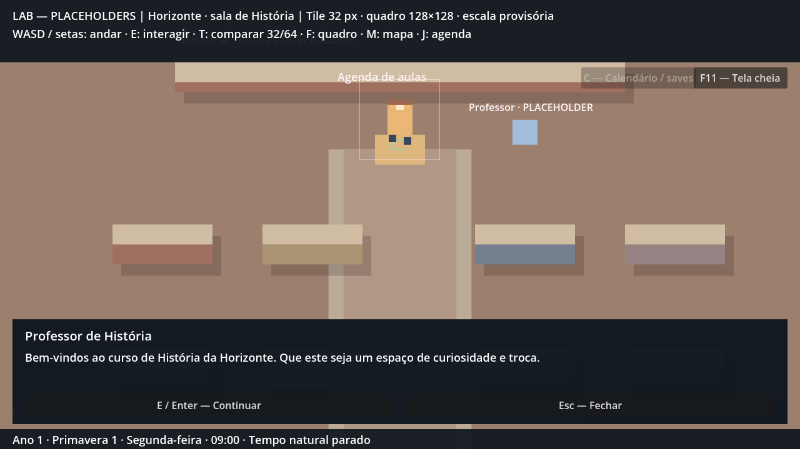

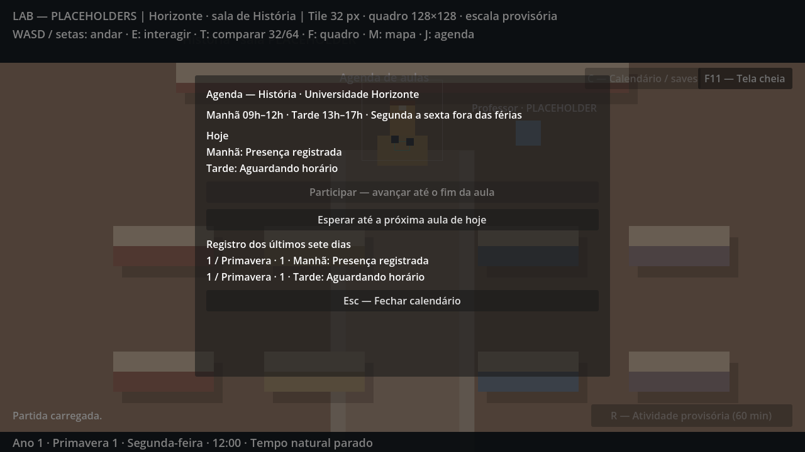

### Limites e próxima tarefa

Professor sem nome/visual/biografia definitivos, sem agenda de NPC ou conteúdo completo de disciplina. Sem notas, perguntas ou avaliações nesta P2-04; o banco de questões é P2-06. Mapa, escala, relógio, sono, calendário, filtros e slots separados mantidos. Drowned não foi acessado/modificado.

Próxima tarefa: **P2-05 — primeira colega/amiga e almoço**, com duas oportunidades de conversa no mesmo dia.


---

## P2-05 — primeira colega e conversa no almoço — 15/10/2026

**Escopo autorizado:** primeira colega/amiga de História, primeiro contato e conversa distinta no almoço, com testes e publicação no GitHub. Nome, aparência e biografia continuam **[PENDENTE]**, conforme GDD; textos e posições são provisórios. Não implementar relações numéricas, romance, diário completo, quiz ou novas regiões.

### Arquivos e comportamento

- `data/npcs/classmate.json`: horários/locais, posições e recursos de diálogo. `data/dialogues/classmate_intro.tres`, `classmate_lunch.tres`, `classmate_waiting.tres`, `classmate_repeat.tres`: primeiro contato, almoço e falas curtas entre/depois dos encontros; todos os textos por chaves em `localization/lab.csv` e recurso pt_BR importado.
- `scripts/core/classmate_encounter.gd`: separa disponibilidade pelo relógio de conversas efetivamente presenciadas. Localização consulta o calendário mínimo já existente e os intervalos dos dados; sinais `changed`/`remembered` e datas de conclusão não dependem de texto de diálogo nem de árvore de cena. Não cria gerenciador geral de elenco.
- **[HIPÓTESE TÉCNICA]** Em dias letivos fora das férias, 06h–12h na sala de História, 12h–13h no hall e 13h–17h na sala. Antes/depois desses horários, fins de semana e férias, não há ator nesta etapa. O começo às 06h e os pontos de espera são convenções do laboratório, sem definir a rotina final da NPC. O almoço usa a janela 12h–13h já autorizada na agenda desta etapa. Troca de posição é direta ao atualizar o relógio, sem animação de caminhada de NPC.
- `classmate_npc.gd` reutiliza o NPC de diálogo, emitindo pedido de encontro com o ator. `dialogue_npc.gd` passa a aceitar cor de placeholder, com valor anterior preservado para os demais NPCs. A colega é um quadrado rosa rotulado PLACEHOLDER, sem visual-base definitivo.
- `scale_lab.gd`: instancia no mapa correspondente, atualiza a presença ao avançar/restaurar o relógio e valida proximidade antes da conversa. Primeiro contato só marca `met_at` após concluir todas as falas. Conhecida a colega, falar com ela no hall entre 12h e 13h abre o almoço; concluir marca `lunch_at`. Esc/Fechar cancela sem registrar nada, mesmo na última fala. Repetições usam fala curta e não duplicam datas/eventos ou autosaves.
- O primeiro encontro pode acontecer antes da aula ou no hall ao meio-dia. Neste segundo caso, a primeira interação apresenta a colega e a seguinte permite o almoço, ainda no mesmo dia. Não é necessário obrigar um encontro automático ou mudar o roteiro do professor. Se perder o almoço, a oportunidade volta em outro dia letivo; o evento não é creditado por mera passagem do tempo.
- Movimento e tempo natural pausam durante a conversa. Diálogos não avançam minutos nem conferem presença acadêmica. R/T/M, portas e debug não podem alterar o contexto de uma conversa pendente. Carregamento/troca interna de mapa/sono limpam a continuação antes de fechar o painel.
- `save_manager.gd` e snapshot: bloco **opcional** `classmate` no esquema **3**, com `met_at` e `lunch_at` em minutos absolutos, `-1` para desconhecido. Validação rejeita campos/tipos inválidos, futuro, almoço anterior ao encontro e registro fora dos dias/horários elegíveis. Ausência do bloco em save anterior inicia ambos desconhecidos sem alterar horário, posição ou frequência. Migrações 1/2 e preferência separada continuam compatíveis.
- Auto opcional grava após concluir cada conversa nova. Abrir, cancelar ou repetir não grava. Manual e auto continuam separados; carregar manual anterior restaura o conhecimento anterior. Não há progresso social global fora dos arquivos de partida. A NPC mudar de local sem jogador não revela encontros, sentimentos, vínculos privados ou memórias desconhecidas. Nenhum diário/afinidade novo foi implementado.
- `tests/classmate_encounter_test.gd`: percurso com física de sala → aula → hall e entradas reais de teclado/mouse, persistência e casos fora do caminho principal. README/AGENTS/nota da planta atualizados com controles, dados, hipóteses e próxima tarefa.

### Como experimentar

Godot 4.7, F5. Na sala, converse com o quadrado rosa à direita das carteiras inferiores usando E. Conclua o primeiro contato. Use a agenda para esperar até 09h e participar da aula; após a apresentação do professor, o horário chega a 12h. Saia para o hall e vá ao centro da área de convivência, próximo ao guia. E abre a conversa de almoço. Conclua antes de esperar pela aula das 13h. Se ainda não conhecer a colega quando chegar ao hall, converse duas vezes para as duas cenas. Esc/Fechar permite cancelar e tentar de novo; não há obrigação de conversar.

### Validação executada

Godot **4.7.2.stable.official.ed1daf0bf**. Importação/editor headless final sem erros. Todos os saves/settings dos runners ficam em `user://test_runs/`, sem alterar slots reais. Capturas renderizadas em 1280×720 e inspecionadas, com os dois personagens separados e texto legível. Sem playtest humano.

| Runner | Verificações finais | Resultado |
|---|---:|---|
| Colega renderizado | 82 (inclui duas capturas) | zero falhas |
| Professor | 45 | zero falhas |
| Agenda acadêmica | 57 | zero falhas |
| Cidade/universidade | 227 | zero falhas |
| Escala/movimento | 60 | zero falhas |
| Relógio | 41 | zero falhas |
| Tempo em interiores | 42 | zero falhas |
| Ações temporizadas | 34 | zero falhas |
| Diálogo anterior | 30 | zero falhas |
| Sono/save/calendário | 51 | zero falhas |
| Resolução/percurso | 12 | zero falhas |
| **Total sem somar variantes repetidas** | **681** | **zero falhas** |

Colega: ator correto e proximidade (incluindo ator inexistente), caminhos físicos desde a porta até a colega, da colega ao ponto de aula, aula/professor até meio-dia e caminhada de saída até o hall; teclado/mouse, held E, bloqueio de atividades/portas/debug; cancelar intro e cancelar última fala de almoço; duas cenas distintas no mesmo dia; tempo/fração/frequência preservados; eventos/datas sem duplicação; nenhuma gravação com auto desligado; cancelamento/repetição sem autosave; manual separado, load durante diálogo, rollback e retomada correta da localização; schema 3 anterior sem bloco, originais intactos; primeiro contato no almoço seguido de segunda conversa; dados inválidos/futuros/invertidos/fora da janela; troca interna de área; limites exatos 05h59/06h/11h59/12h/12h59/13h/16h59/17h; fim de semana/férias; disponibilidade sem conhecimento fabricado e almoço perdido recuperável no próximo dia letivo.

Comando novo: `godot --headless --path . --script res://tests/classmate_encounter_test.gd`. Para duas capturas, retirar `--headless` e acrescentar `-- --capture`. Demais runners conforme README. Logs em `test-results/p205-*.log`, ignorados pelo Git; o runner do professor usa `p205-professor.log`. As 80 verificações da variante headless da colega estão contidas nas 82 renderizadas; não somar novamente. A circulação urbana foi repetida com aceleração de teste, sem nova medição de caminhada em velocidade normal.

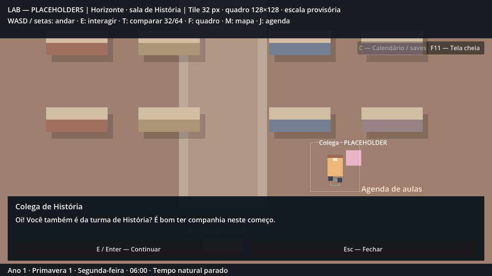

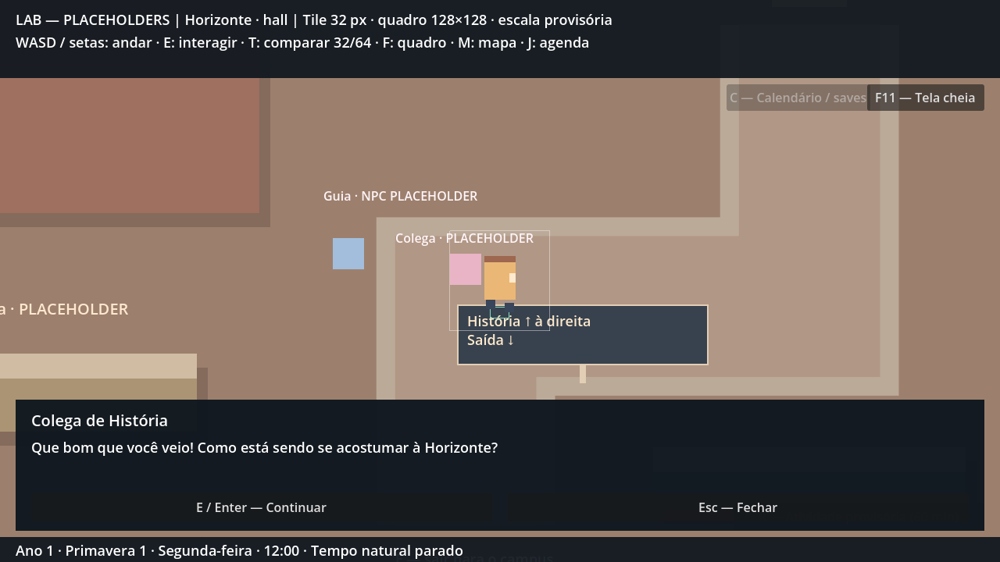

### Limites e próxima tarefa

Identidade, personalidade/falas finais, rotina completa e arte da colega pendentes. A presença mínima usa horários fixos em dados, sem navegação entre áreas; não inclui refeição com duração/preço, seleção de prato, sistema geral de amizades ou diário social. Dois encontros amigáveis não afirmam romance nem revelam afinidade interna. Mapa, escala, sono, calendário, filtros, agenda/presenças e saves anteriores preservados. Drowned não foi acessado/modificado.

Próxima tarefa: **P2-06 — banco de questões e primeira pergunta**, quatro alternativas, reação e registro da resposta.

## 2026-10-15 — P2-06: primeira pergunta em aula

### Escopo e comportamento

Somente a P2-06 do roadmap. Banco mínimo reutilizável em `data/questions/history.json`: uma questão de História com quatro alternativas, IDs estáveis, gabarito, chaves de reação/explicação e fonte. `ClassQuestionBank` valida o formato e guarda uma cópia em memória; editar os dados requer reiniciar o jogo. Não reutilizar IDs para outros enunciados ou alternativas: o save referencia esses identificadores.

Questão de teste: ano do episódio do Grito do Ipiranga, em 7 de setembro. Alternativas 1500, 1822, 1889 e 1930; correta 1822. A pergunta delimita um episódio, evitando tratar todo o processo de independência como um acontecimento instantâneo. Referência consultada: [Biblioteca Nacional — 1822: Independência do Brasil](https://bndigital.bn.gov.br/dossies/gramaticas-e-dicionarios-do-portugues/linha-do-tempo/sobre-as-efemerides/1822-independencia-do-brasil/). Formulação, falas e conteúdo da disciplina continuam provisórios, sem fixar a ementa final.

**[HIPÓTESE TÉCNICA]** A primeira participação elegível à tarde apresenta a questão uma vez por partida salva. Perder a manhã ou um dia inteiro não elimina essa oportunidade. Não há questão pela manhã, após 17h, em fim de semana ou férias. Se a apresentação do professor ainda estiver pendente, ela vem primeiro e continua para a questão sem avançar o relógio. Cancelar nessa etapa não marca a apresentação como concluída; a tentativa pode ser retomada. As quatro alternativas não têm cronômetro: o seminário temporizado é um sistema posterior do GDD.

Escolha por mouse ou 1–4. Movimento, relógio natural, atividades, mapa, agenda, portas e salto debug ficam bloqueados durante o painel. Antes de escolher, Esc/Cancelar volta à agenda sem avanço/presença/resposta. Escolher valida a alternativa e reserva o resultado/presença antes dos eventos cronológicos, avança apenas o restante da aula até 17h, mostra reação e permite fechar com Continuar/Enter/Esc. Depois de responder, todas as opções ficam desabilitadas; fechar a reação não desfaz nem repete o resultado. Acerto recebe incentivo; erro recebe correção gentil, sem punição extra nem alteração da presença. Ambos encerram a mesma aula.

Registro em `academics.question_answers`, por ID da questão: `option_id`, `correct`, `answered_at` e `session_key`. A agenda J mostra data/estação/ano, turno, enunciado, escolha e resultado no final do histórico. Um acerto fica registrado como participação correta; pesos, recompensa numérica e fórmula de notas permanecem **[PENDENTE]**, conforme o GDD. Não há atributos ocultos, nota final, avaliação, seminário, sorteio de perguntas ou sistema de semestre antecipado.

### Arquivos e persistência

- `data/questions/history.json` e `scripts/core/class_question_bank.gd`: banco validado, IDs e fonte.
- `scripts/ui/class_question_panel.gd`: quatro opções, teclado/mouse, reação e cancelamento.
- `scripts/core/academic_schedule.gd`: exigência da resposta na primeira tarde, registro, presença e validação.
- `scripts/lab/scale_lab.gd`: continuação professor → questão → resultado, autosave e limpeza ao carregar/trocar área/dormir.
- `scripts/ui/academic_panel.gd`, `localization/lab.csv` e tradução gerada: consulta do resultado e textos por chaves. en/es completos continuam para a beta.
- Runner novo `tests/class_question_test.gd`; suites de professor e agenda adaptadas à etapa adicional. README, AGENTS e referência da cidade atualizados.

Esquema 3 preservado. `question_answers` é opcional para arquivos da P2-03/04/05; ausência equivale a nenhuma resposta, preservando posições, horários, apresentação, encontros e frequência. A questão será oferecida na próxima tarde elegível ainda não frequentada. Migrações dos esquemas 1/2 continuam inicializando apenas o histórico acadêmico necessário, sem escrever sobre os originais. O validador recusa ID desconhecido, alternativa inválida, gabarito adulterado, data fracionária/futura, turno errado e resposta que não corresponda ao instante de entrada de uma presença válida. Rejeição não sobrescreve o slot.

Auto opcional grava o resultado e a frequência ao concluir a aula, antes de fechar a reação. Manual continua sendo oferecido antes do sono em arquivo separado; inclui a resposta. Carregar um save anterior restaura a elegibilidade daquele instante. Carregar durante o painel elimina a continuação pendente; não inventa resposta nem presença. Resposta incorreta também permanece final nas tardes seguintes. Alterar área internamente limpa o painel sem executar o retorno normal à agenda.

### Validação executada

Godot **4.7.2.stable.official.ed1daf0bf**. Importação/editor headless sem erros. Todos os runners usam `user://test_runs/`, sem tocar nos slots reais. Capturas renderizadas e inspecionadas em 1280×720 e 960×540. Sem playtest humano.

| Runner | Verificações finais | Resultado |
|---|---:|---|
| Questão renderizada | 104 (inclui quatro capturas) | zero falhas |
| Professor | 47 | zero falhas |
| Agenda acadêmica | 58 | zero falhas |
| Colega | 80 | zero falhas |
| Cidade/universidade | 227 | zero falhas |
| Escala/movimento | 60 | zero falhas |
| Relógio | 41 | zero falhas |
| Tempo em interiores | 42 | zero falhas |
| Ações temporizadas | 34 | zero falhas |
| Diálogo anterior | 30 | zero falhas |
| Sono/save/calendário | 51 | zero falhas |
| Resolução/percurso | 12 | zero falhas |
| **Total sem somar variantes repetidas** | **786** | **zero falhas** |

Questões: dados/chaves/fonte; banco inválido; clique real e todas as quatro teclas; Enter/eco não selecionam; cancelamento por mouse/Esc; relógio/fração pausados; bloqueio de ações; exatamente um evento de presença e todos os minutos restantes, incluindo chegada 16h59; acerto/erro com presença idêntica; callbacks/cliques repetidos não alteram resultado; registro visível na agenda; auto separado antes de fechar; rollback; load durante pergunta; manual pelo fluxo real antes de dormir e restauração da escolha errada; ausência do bloco em save antigo; dados corrompidos; cancelamento ao trocar área; primeira aula à tarde depois de perder a manhã/dia anterior; calendário sem aulas; alternativas, reação e Continuar visíveis em 960×540. A variante headless tem 100 verificações, todas incluídas nas 104 renderizadas; não somar novamente.

Comando novo: `godot --headless --path . --script res://tests/class_question_test.gd`. Para quatro capturas, retirar `--headless` e acrescentar `-- --capture`. Captura usa [`RenderingServer.force_draw(false)`](https://docs.godotengine.org/en/4.7/classes/class_renderingserver.html#class-renderingserver-method-force-draw) no runner: a espera de um novo frame renderizado podia ficar suspensa quando a janela oculta não precisava redesenhar. O processo desse teste inicial foi encerrado, o runner corrigido e a versão final renderizada completou sem erros. Nenhuma mudança no renderizador do jogo.

Logs locais em `test-results/p206-*.log`, ignorados pelo Git. A circulação da cidade foi repetida com aceleração de teste 6×; não é uma nova medição em velocidade normal.

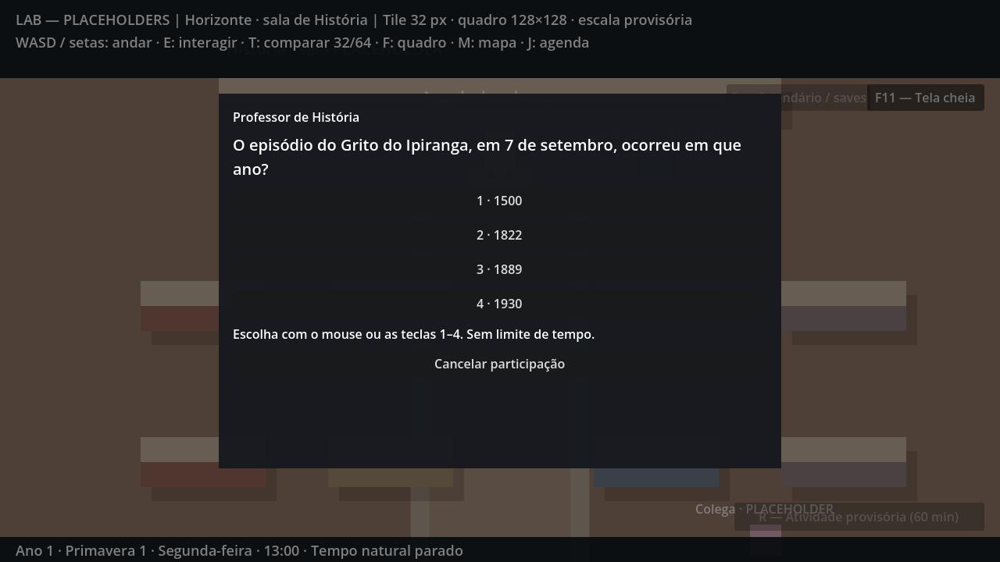

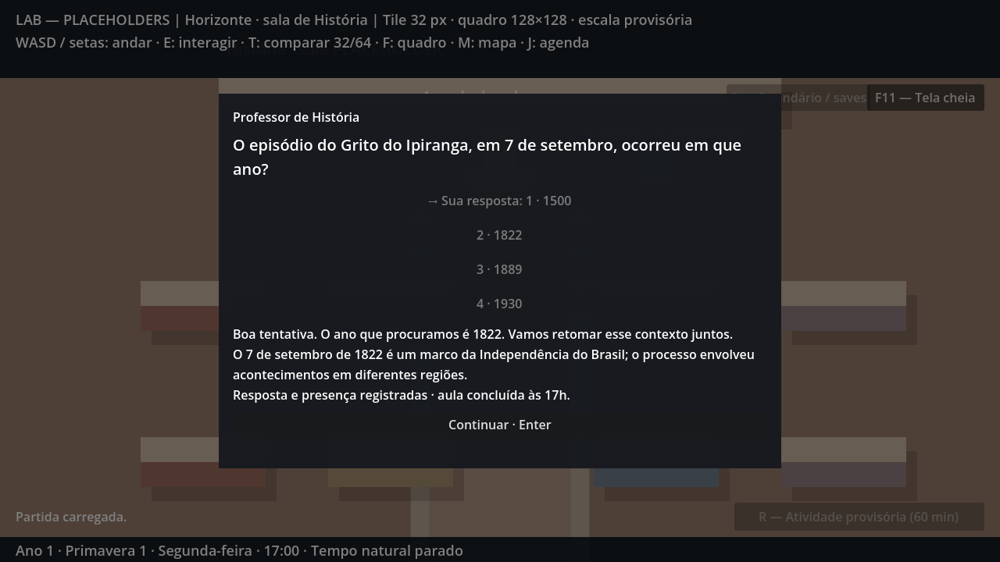

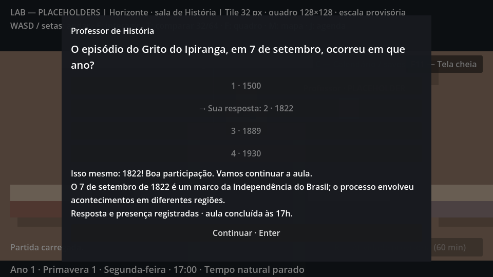

### Limites e próxima tarefa

Banco contém uma questão de teste. Mais questões, ementa, nomes/arte finais do professor, pesos/notas e recompensas numéricas continuam **[PENDENTE]**. Escala, mapa, fade, colega/almoço, sono, calendário e saves anteriores preservados; Drowned não foi acessado/modificado.

Próxima tarefa: **P2-07 — eventos curtos de pai/irmã e música no quarto**, com descoberta dos hobbies previstos no GDD.

## 2026-10-15 — P2-07: família e descoberta dos hobbies

### Escopo e conteúdo

Somente P2-07. A rota prevista no GDD tem cumprimentos familiares antes da universidade e introduções dos hobbies no retorno. Pai e irmã recebem duas cenas cada: cumprimento matinal e convite noturno, com falas breves de repetição. Pai apresenta skate; irmã apresenta fliperama/videogames. O cantinho de música no quarto tem descoberta e repetição próprias. São exatamente os três hobbies canônicos. A mãe não virou NPC de rotina; não há revelação de segredos, arcos de trabalho/bullying/romance ou tarefas familiares condicionando dinheiro/afeto.

Falas são placeholders por chaves em `localization/lab.csv`. O pai demonstra curiosidade por skate e convida a aprender junto; a irmã apresenta um jogo e convida sem obrigar; o protagonista identifica um canto para explorar música. O instrumento definitivo permanece **[PENDENTE]**, portanto o ponto é um quadrado roxo identificado como música, sem escolher um instrumento pelo criador. Não há minigames, prática musical com áudio, XP/níveis, recompensa monetária ou progresso de habilidade nesta entrega. As atividades funcionais ficam para a fase 3.

**[HIPÓTESE TÉCNICA]** Pai/irmã aparecem no interior de teste da casa entre **06h–08h** e **17h–23h**, diariamente, inclusive fins de semana/férias. A manhã permite os cumprimentos; à noite, os convites dos hobbies. É uma disponibilidade mínima para testar a introdução, sem afirmar horários canônicos de emprego/escola, deslocamentos ou rotinas completas. Música está disponível a qualquer horário em casa fora das 04h, preservando o sono obrigatório. O mesmo quarto do laboratório representa provisoriamente o interior doméstico; não foram criados cômodos/casa completa nem alterado o mapa urbano.

O NPC genérico do quarto foi substituído pelo pai; irmã e cantinho de música usam o mesmo ator/área de proximidade com um sinal contextual. Personagens/pontos são montados de `data/events/home_introductions.json`, com posições, cores, marcadores e recursos de diálogo. O NPC genérico da rua permanece para regressão do diálogo anterior. Escala do protagonista, zoom, mobília e colisões de tiles 32/64 continuam iguais.

### Eventos e conhecimento

E próximo abre o diálogo existente; Enter/E/Continuar avança, Esc/Fechar cancela. Só concluir a última fala lembra o evento. Cancelar no último texto continua sendo cancelamento, sem descoberta/autosave. Conversar pausa movimento/tempo, bloqueia atividades, portas, mapa, agenda/interesses e salto debug. Não consome minutos, não concede frequência nem escolhe atividade obrigatória. Depois de concluir uma introdução, repetir usa uma fala curta sem regravar o evento ou autosave.

Não há requisito de cumprimento prévio, aula frequentada ou ordem entre pai/irmã/música. Música pode ser descoberta de manhã, antes de ir à universidade. Perder a noite ou o primeiro dia permite retomar em outro dia; a oportunidade não depende do dia inicial nem do calendário acadêmico. Sair de casa e dormir são permitidos com descobertas pendentes.

`HomeIntroductions` guarda apenas conhecimento confirmado: `greetings` por ator e `discovered` por hobby, com minutos absolutos de conclusão. A presença dos atores é calculada a partir do relógio e não concede conhecimento fora de cena. Eventos de conclusão emitem sinais reutilizáveis; nenhuma relação interna é revelada ou fabricada.

H / botão **Interesses** abre uma lista simples dos hobbies já descobertos e uma indicação genérica de que ainda há coisas a descobrir. Nomes de hobbies não descobertos não aparecem nesse painel; não é um diário social completo. O aviso após cada nova descoberta aponta para H. O painel pausa o relógio exterior sem consumir a fração do minuto e respeita os bloqueios modais existentes. Fundo opaco mantém o texto legível em 960×540.

### Arquivos e save

- `data/events/home_introductions.json` e dez recursos `data/dialogues/father_*.tres`, `sister_*.tres`, `music_*.tres`: disponibilidade, posições, três hobbies e falas reutilizáveis.
- `scripts/core/home_introductions.gd`: disponibilidade/conversa, memórias, descobertas e validação de timestamps.
- `scripts/world/home_event_point.gd`, `scripts/lab/scale_lab.gd`, `scenes/world/room.tscn`: interação de proximidade, continuação segura e atores placeholders.
- `scripts/ui/hobbies_panel.gd`, `scenes/lab/scale_lab.tscn`, `localization/lab.csv` e tradução gerada: consulta por H/botão e textos.
- `scripts/core/save_manager.gd`: validação do bloco novo; `tests/home_introductions_test.gd` novo e runner de diálogo adaptado ao pai no quarto. README, AGENTS e referência da cidade atualizados.

O esquema permanece **3**. `home_introductions` é opcional para arquivos anteriores; sem ele, cumprimentos/descobertas iniciam vazios, sem alterar posição, relógio/fração, frequência, respostas ou colega. Campos novos têm apenas IDs conhecidos e minutos inteiros não negativos, não futuros, compatíveis com a janela da conversa. Hobby familiar antes das 17h, cumprimento à noite, hobby desconhecido, descoberta às 04h e valores inválidos são recusados. JSON restaura números como floats: o módulo normaliza os minutos validados para inteiros ao restaurar. Isso foi corrigido durante o teste de rollback, que inicialmente detectou diferença entre o dicionário em memória e o carregado.

Manual antes do sono e auto opcional permanecem em arquivos separados. Auto grava somente após novo cumprimento ou descoberta concluída; repetição/cancelamento não grava. Load durante diálogo limpa a continuação pendente antes de restaurar conhecimento/localização; rollback devolve as oportunidades daquele save. Uma troca interna de área também cancela a continuação sem conceder evento. Arquivo inválido é rejeitado antes de alterar a partida. Saves antigos carregam sem regravar o original. Migrações 1/2 permanecem preservadas.

### Validação executada

Godot **4.7.2.stable.official.ed1daf0bf**. Importação/editor headless final sem erros. Runners usam `user://test_runs/`, isolando saves/settings reais. Cinco capturas renderizadas e inspecionadas em 1280×720 e 960×540. Sem playtest humano.

| Runner | Verificações finais | Resultado |
|---|---:|---|
| Família/hobbies renderizado | 114 (inclui cinco capturas) | zero falhas |
| Questão | 100 | zero falhas |
| Professor | 47 | zero falhas |
| Agenda acadêmica | 58 | zero falhas |
| Colega | 80 | zero falhas |
| Cidade/universidade | 227 | zero falhas |
| Escala/movimento | 60 | zero falhas |
| Relógio | 41 | zero falhas |
| Tempo em interiores | 42 | zero falhas |
| Ações temporizadas | 34 | zero falhas |
| Diálogo anterior | 30 | zero falhas |
| Sono/save/calendário | 51 | zero falhas |
| Resolução/percurso | 12 | zero falhas |
| **Total sem somar variantes repetidas** | **896** | **zero falhas** |

Família/hobbies: recursos/chaves das dez conversas; exatamente três hobbies; consulta sem nomes desconhecidos; ator remoto/inexistente/incorreto; caminhada física desde o ponto inicial até pai/irmã/música, inclusive contornando mesa, em tiles 32/64; input real de teclado/mouse; cumprimento sem descoberta antecipada; eventos distintos à noite; cancelamento na última fala, eco, repetição sem autosave; bloqueios de tempo/atividades/portas/mapas; nenhuma presença acadêmica; retorno para casa com fade e atores corretos; nenhum conhecimento por salto de calendário; manual/auto separados; load durante conversa, rollback e retomada; manual real antes do sono/restauração da escolha pendente; schema 3 sem o bloco, bytes originais intactos; dados inválidos e load corrompido preservando estado atual; cancelamento por troca de área ou relógio alterado; limites exatos 05h59/06h/07h59/08h/16h59/17h/22h59/23h/meia-noite/dia seguinte; retomada no fim de semana em ordem inversa sem cumprimentos; música 03h59, sono obrigatório 04h e alarme 06h; textos/controles em notebook; consulta exterior preserva fração 0,75 e retoma exatamente o próximo minuto.

Runner novo: `godot --headless --path . --script res://tests/home_introductions_test.gd`. Para cinco capturas, retirar `--headless` e acrescentar `-- --capture`. Variante headless tem 109 verificações, incluídas nas 114 renderizadas; não somar novamente. Aceleração de movimento 3× somente no runner doméstico, sem mudar a velocidade de produção. O runner urbano foi repetido com aceleração 6×, sem nova medição de percurso em velocidade normal. Logs em `test-results/p207-*.log`, ignorados pelo Git.

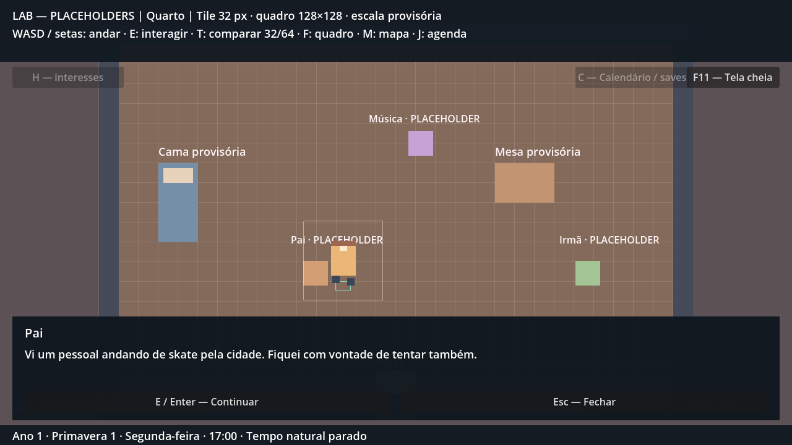


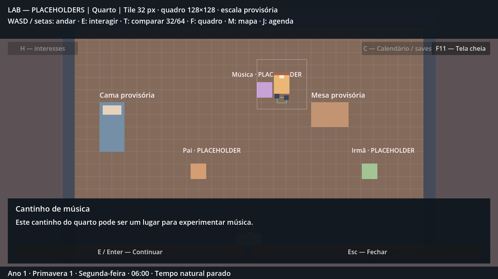

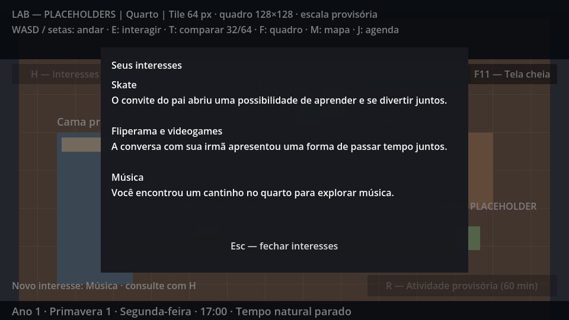

### Limites e próxima tarefa

Nomes, arte, falas finais, instrumento e rotinas familiares completas continuam **[PENDENTE]**. Esta entrega cobre introdução/descoberta; nenhum hobby já possui minigame/prática funcional. Mapa, escala, aulas/questão, colega/almoço, sono, calendário e saves anteriores preservados. Drowned não foi acessado/modificado.

Próxima tarefa: **P2-08 — fluxo do fim do dia e teste completo do Dia 1**, percorrendo todas as apresentações e o sono/salvamento em uma partida contínua, incluindo desvios sem bloqueios.

## 2026-10-16 — P2-08: encerramento e Dia 1 contínuo

### Entrega e checkpoint

Somente P2-08. O Dia 1 foi executado do começo ao fim em duas partidas novas, tiles 32/64: nome escolhido, cumprimentos familiares, caminhada até a Horizonte, aula da manhã, primeiro contato e almoço no hall, questão da tarde, volta a pé para casa, três hobbies, cama, save e manhã seguinte. Reiniciar a cena e carregar os arquivos reais preserva nome, posição, horário/alarme, apresentação, frequência, resposta, colega e hobbies. Nenhum teleporte, `change_area`, restauração de relógio ou salto debug é usado para vencer as rotas principais; horários avançam por caminhada exterior e pelas atividades/sono da interface.

O checkpoint P2 está concluído nas rotas e desvios testados, sem afirmar que todas as combinações possíveis de entrada/hardware foram cobertas. Roteiro, matriz dos critérios do GDD e comandos em `docs/day_one_validation.md`. A partida continua livre: cancelar, faltar ou dormir sem concluir conteúdo não provoca bloqueio. F5 ainda inicia diretamente a cena de laboratório; nome é escolhido em C. Menu principal dedicado e conteúdo final continuam pendentes.

### Ajustes de fluxo

- `TimeManager.calendar_at(minutes, offset)` extrai a consulta pura da data; `get_calendar()` conserva os resultados anteriores. A previsão do sono usa essa função sem mover o relógio.
- `SleepPanel` mostra dia, estação, ano e dia da semana do despertar, mais horário/duração. Texto informa que atividades não são obrigatórias. Fundo opaco e área 660×460 mantêm decisões legíveis em 960×540.
- 1 salva manualmente e dorme; 2 dorme sem manual. Mouse continua disponível. Os atalhos só recebem input não consumido pela interface: digitar um número no alarme em foco não inicia o sono. Esc continua limitado ao sono voluntário.
- `_choose_sleep` exige sono pendente e ausência de transição. Uma chamada repetida após acordar não regrava o manual com o estado posterior nem dorme novamente.
- `DialoguePanel.text_context` formata chaves traduzíveis; nome e saudação são atualizados ao editar em C e ao carregar. O cumprimento do pai usa a saudação nomeada; nome vazio mantém um cumprimento natural, sem separador sobrando. Recursos anteriores continuam funcionando sem variáveis.

Não há novo manager, sistema de recompensa, portão de conclusão, mudança no cânone/horários autorizados ou esquema novo de save. Manual continua antes do sono e auto opcional depois de acordar, em arquivos separados. O fluxo de falha existente foi exercitado com erro real de criação da pasta: estado e manual anterior preservados, possibilidade de prosseguir sem manual e tentativa posterior na mesma escolha funcionando.

### Arquivos

`scripts/core/time_manager.gd`, `scripts/ui/sleep_panel.gd`, `scripts/dialogue/dialogue_panel.gd`, `scripts/lab/scale_lab.gd`, `localization/lab.csv` e tradução gerada; runner novo `tests/day_one_flow_test.gd`; runners de diálogo/família adaptados ao texto parametrizado. README, AGENTS, referência da cidade e guia `docs/day_one_validation.md` atualizados. Quatro capturas próprias desta entrega.

### Validação executada

Godot **4.7.2.stable.official.ed1daf0bf**. Importação/editor final sem erros. Os runners usam somente `user://test_runs/`, sem ler/gravar slots reais. Interface renderizada e inspecionada em 1280×720 e 960×540. Sem playtest humano.

| Runner | Verificações finais | Resultado |
|---|---:|---|
| Dia 1 contínuo renderizado | 141 (inclui quatro capturas) | zero falhas |
| Família/hobbies | 109 | zero falhas |
| Questão | 100 | zero falhas |
| Professor | 47 | zero falhas |
| Agenda acadêmica | 58 | zero falhas |
| Colega | 80 | zero falhas |
| Cidade/universidade | 227 | zero falhas |
| Escala/movimento | 60 | zero falhas |
| Relógio | 41 | zero falhas |
| Tempo em interiores | 42 | zero falhas |
| Ações temporizadas | 34 | zero falhas |
| Diálogo anterior | 30 | zero falhas |
| Sono/save/calendário | 51 | zero falhas |
| Resolução/percurso | 12 | zero falhas |
| **Total sem somar variantes repetidas** | **1032** | **zero falhas** |

Os 137 checks da variante headless do Dia 1 estão incluídos nos 141 renderizados; não somar novamente. A primeira execução renderizada com `--walk` completou o primeiro Dia 1 em escala de tempo 1, incluindo ida e volta; o segundo usa 6×. Ida exterior: **41,548 segundos de parede**, chegada **06h40**, margem **140 minutos** até a aula. A cronometragem inclui interações/fades na rota. Essa execução precedeu o último check de digitação do alarme e tinha 140 checks com quatro capturas; está em `test-results/p208-normal-speed.log` e também não entra novamente no total. A versão final, com atalhos/alarme, foi renderizada com 6× nos dois trajetos, sem alterar velocidade ou zoom de produção.

Desvios com fixtures explícitas: cancelar apresentação/almoço/questão/sono; dormir imediatamente sem apresentações/hobbies ou slots; recuperar a primeira aula/pergunta em tarde posterior, chegando atrasado e errando; 04h exterior com frame longo, volta com fade e despertar 12h no mesmo dia; sono em casa respeitando alarme; falha de gravação, opção de continuar e nova tentativa; load inválido sem mutação; callback repetido depois de acordar; alarme em foco e decisões alcançáveis em notebook. A falha de pasta é induzida colocando um arquivo no lugar do diretório pai: as mensagens `Could not create directory` nos logs desse trecho são esperadas e verificam a recuperação; não há erro de script nem falha de asserção.

Comandos completos em `docs/day_one_validation.md`. Logs em `test-results/p208-*.log`, ignorados. A unidade E: deixou de estar disponível nesta sessão; o trabalho continuou em cópia isolada em C: a partir do commit publicado da P2-07, sem mexer na cópia inacessível. O binário 4.7.2 foi obtido novamente da [distribuição oficial](https://godotengine.org/download/archive/4.7.2-stable/) e conferido com SHA-512 do release. Nenhum arquivo de Drowned foi acessado/modificado.

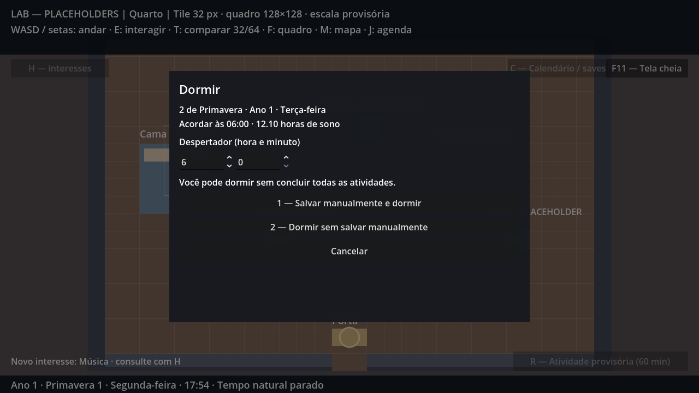

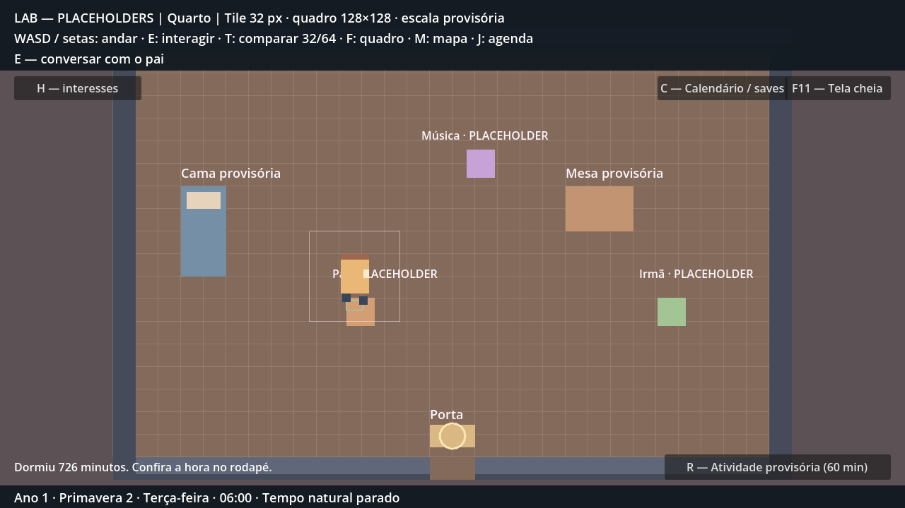

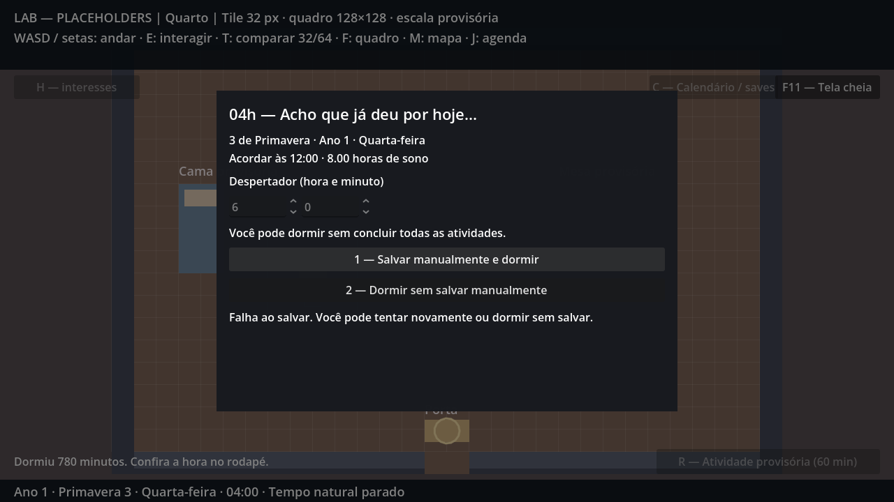

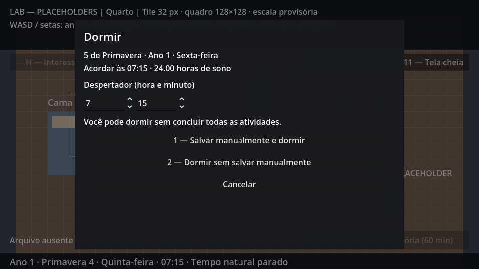

### Limites e próxima tarefa

Sem menu principal dedicado, arte/instrumento finais, prática musical, minigames, notas/recompensas ou rotinas completas. Permanecem as hipóteses de horários domésticos e calendário inicial. As rotas principais foram caminhadas; casos de limite usam fixtures claramente separadas. O GDD histórico não foi reescrito.

Próxima tarefa: **P3-01 — calendário completo e férias**, começando pela auditoria do calendário/agenda existentes para evitar duplicação ou regressão.
