# Primeira sessão técnica — 12/10/2026

## Escopo e ordem

Registro da primeira entrega: **primeira sessão técnica da seção 15 do GDD**, conforme a prioridade do AGENTS.md. Apenas o laboratório de escala, movimento e quarto↔rua. A tarefa atual P1-06 está registrada ao final deste documento.

| Roadmap | Estado nesta entrega |
|---|---|
| P0-01 | Projeto próprio e Git inicializados; Godot 4.5 executada |
| P0-02 | GDD/AGENTS preservados; README e gitignore adicionados/complementados |
| P0-03 | **[PENDENTE]** Nenhum caminho/recurso de Drowned foi disponibilizado; nenhuma auditoria nem reutilização presumida |
| P0-04 | Laboratório com quadro 128×128, porta, cama, mesa e fachada; alternância 32/64 |
| P0-05 | Comparação visual registrada; 32 escolhido somente como padrão técnico provisório |
| P1-01 | Movimento 8 direções, animações/idle 4 direções, diagonal normalizada |
| P1-02 | Mapas de teste quarto/rua e porta interativa com marcadores de entrada |

P0-03 não impede a seção 15: o GDD condiciona a inspeção de Drowned ao acesso. Nenhum arquivo daquele projeto foi lido ou alterado.

## Hipóteses técnicas, sem alteração do cânone

- **[PROPOSTA]** Viewport 960×540, câmera sem suavização e zoom 1; filtro nearest. Valores ajustáveis após playtest.
- **[PROPOSTA]** Tile padrão 32 px. Com o mesmo corpo placeholder, cama de 64×128 e porta de 64 px têm proporções mais compactas; em 64, a cama passa a 128×256 e a porta a 128 px. A comparação permanece acessível com T; não há produção de tiles finais.
- **[PENDENTE]** Aprovação criativa do tile e câmera. Os screenshots validam legibilidade técnica; não substituem playtest de conforto pelo criador.
- **[PROPOSTA]** Velocidade 180 px/s, corpo desenhado com 40×56 e pés, dentro de quadro 128×128; colisão 24×14 junto aos pés. Quadro não é tamanho do corpo.
- **[PROPOSTA]** Empates diagonais usam orientação horizontal. Parado, retém a última orientação.
- **[PROPOSTA]** Interação por E dentro da área de porta. A transição ocorre diferida, fora da atualização física; um personagem e uma área ativos, sem manager global prematuro.
- **[PROPOSTA]** T reposiciona o jogador no marcador seguro para evitar sobreposição após aumentar a mobília.
- **[PENDENTE]** Arte, nomes, disposição definitiva de casa/rua, localização completa en/es. Nada no mapa de teste determina geografia canônica.

## Capturas da engine

As quatro imagens foram renderizadas pela Godot 4.5 e inspecionadas visualmente. Personagem conserva a escala ao alternar o tile.

| Quarto 32 | Quarto 64 |
|---|---|
| 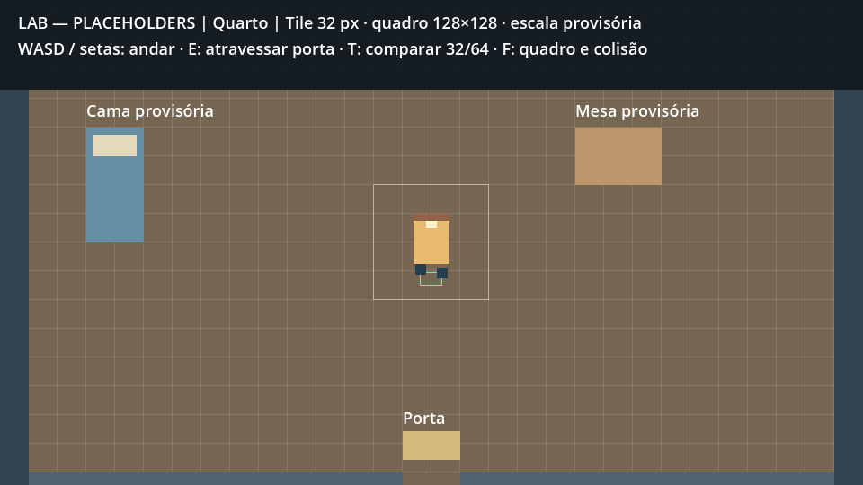 | 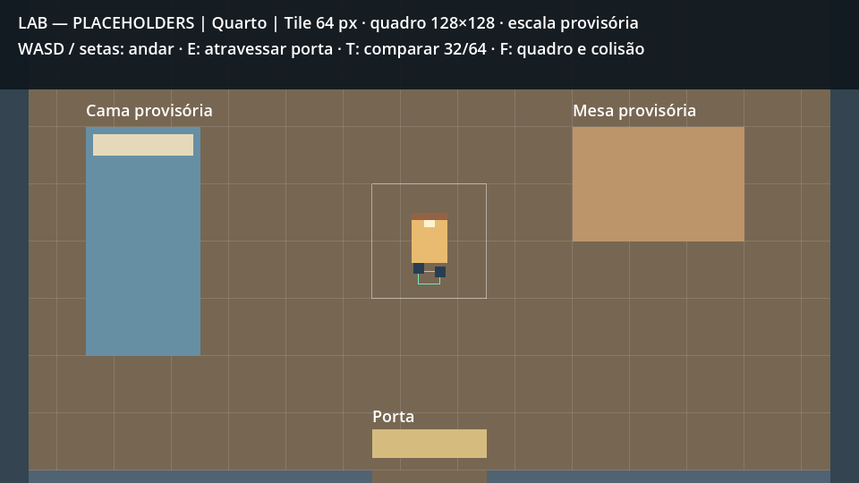 |

| Rua 32 | Rua 64 |
|---|---|
| 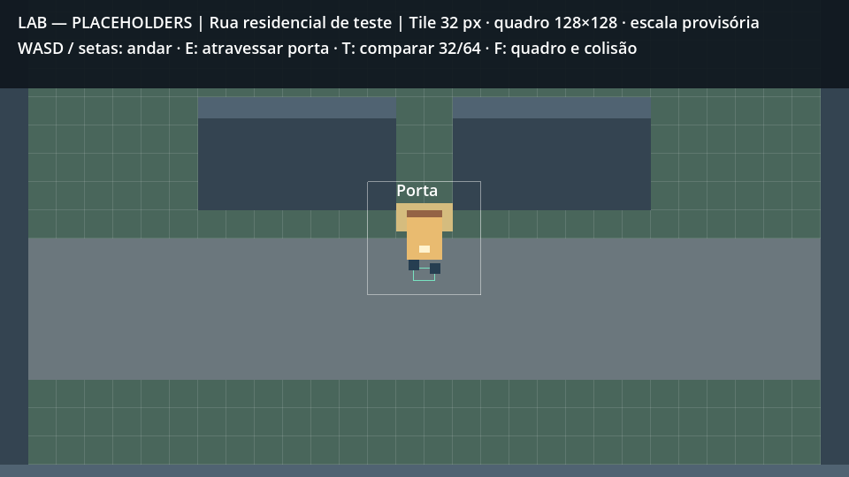 | 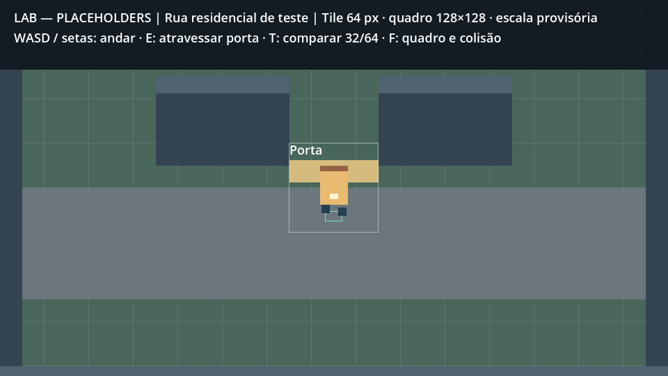 |

## Resultado da validação

Engine: `4.5.stable.official.876b29033`. Importação no editor headless; runner com física real; renderização OpenGL para screenshots. Logs locais em `test-results/`, ignorados pelo Git.

O runner cobre movimento/idle, dimensões dos quadros, tradução, colisões de parede/cama/mesa, portas acessíveis caminhando, recusa de interação distante, seis ciclos ida/volta com spawn correto em 32 e 64 e apenas uma área ativa. **60 verificações headless; mais 4 capturas no modo renderizado.** Não foi feito playtest humano nem validação de arte final.

Problema corrigido na inspeção: HUD encobria os objetos no enquadramento inicial; cama, mesa e fachada foram deslocadas para ficarem visíveis. O runner aguarda a sincronização de overlaps do servidor físico antes de interagir.

## Próxima tarefa sugerida

Após a primeira sessão, foi sugerida **P1-03 — TimeManager**, executada na entrega abaixo.

---

## P1-03 — relógio externo — 12/10/2026

**Escopo autorizado:** TimeManager com 60 segundos reais por hora do jogo e testes de minutos, meia-noite, estação/ano e dias da semana. Não foram adicionadas atividades com duração, férias, agendas, sono ou saves.

### Implementação e hipóteses

- `scripts/core/time_manager.gd`: nó reutilizável com minutos absolutos; não usa o relógio/data do sistema para definir o calendário. O laboratório conserva uma única instância nas trocas de mapa, sem Autoload nesta etapa.
- Um segundo de `_process(delta)` equivale a um minuto. Frações são acumuladas; cada minuto intermediário emite `minute_changed`, e cada meia-noite emite `day_changed`, nessa ordem. A tolerância numérica de 1e-9 s evita perder um minuto ao somar frames de 1/60 s.
- Calendário derivado: quatro estações de 30 dias; 120 dias por ano; dias da semana e número da semana continuam entre estações/anos. Sem lógica de férias/compromissos (P3-01).
- **[PROPOSTA]** Origem do laboratório: primavera 1, ano 1, 06h. **[PENDENTE]** Dia da semana canônico inicial. `weekday_offset` vai de 0 (segunda) a 6 (domingo), com 0 como padrão técnico provisório.
- A rua ativa o relógio; o quarto não o ativa. Essa conexão mínima é necessária para não avançar tempo natural em interiores contra o GDD. P1-04 continua como tarefa própria para consolidar e verificar a pausa, preservação de frações e transições repetidas; não foi criado sistema de UI/cutscene ou atividades.
- O nó usa o modo pausable padrão da Godot. UI de pausa ainda não existe.
- Label no rodapé usa chaves traduzíveis para data/hora, estações, dias da semana e estado do relógio. Foi regenerado `lab.pt_BR.translation` com a Godot 4.5.

### Como testar

Abra o projeto na Godot 4.5 e execute F5. O rodapé começa em 06:00; saia pela porta com E e observe o minuto mudar a cada segundo. Voltar ao quarto preserva a data/hora, com tempo natural desativado. Os demais controles do laboratório continuam disponíveis.

Runners reproduzíveis e opções de medição/captura estão no README. `time_manager_test.gd` executa testes determinísticos pela própria Godot e, com `--realtime`, mede também um minuto real em execução externa. Os testes chamam o mesmo callback de produção; não existe API de atividade com duração nesta entrega.

### Validações executadas

- Godot `4.5.stable.official.876b29033`: importação/editor headless sem erros de script ou recurso.
- **41 verificações determinísticas do relógio, zero falhas**, incluindo eventos cronológicos e integração com HUD/transições.
- Medição na engine renderizada: **60,028 segundos reais → +60 minutos do jogo**, sem aceleração artificial. A captura também passou; execução completa: **43 verificações, zero falhas**.
- Regressão do laboratório: **60 verificações de movimento, colisões e portas, zero falhas**.
- Captura abaixo inspecionada visualmente: rodapé legível, sem encobrir os controles. A captura mostra 08h porque o runner avançou uma hora deterministicamente antes de medir a hora em tempo real.

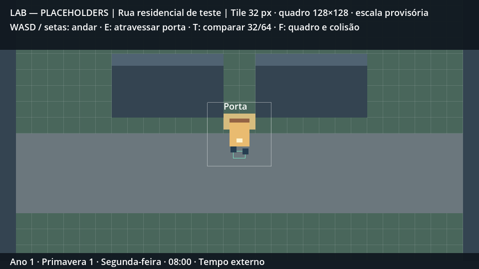

Limitações desta tarefa: sem playtest humano, menu de pausa, atividades com duração ou sono compulsório. O limite das 04h continua fora desta entrega, conforme P1-07. A origem do dia da semana continua **[PENDENTE]**.

### Próxima tarefa

**P1-04 — consolidar e validar pausa temporal em interiores.** P1-05 adicionará atividades com duração; P1-07 fará o limite de sono às 04h.

---

## P1-04 — pausa temporal em interiores — 12/10/2026

**Critério de aceite:** o relógio natural para ao entrar e volta ao sair, preservando data/hora. A ligação `time_manager.running = area.exterior` já havia sido incluída em P1-03 para respeitar o GDD. A validação desta tarefa confirmou esse comportamento sem exigir alteração do código de produção.

### Alterações e cobertura

- `tests/interior_time_test.gd`: runner dedicado na Godot 4.5, com relógio/cenas/portas reais do laboratório.
- Congelamento de 60 segundos simulados no quarto, sem eventos de minuto ou dia; jogador continua andando com o SceneTree ativo.
- Entrada/saída pelo caminho de interação E e overlap da porta; vinte ciclos adicionais de troca de mapa, preservando a instância do relógio e apenas uma área ativa.
- Frações verificadas por comportamento observável: 0,75 s fora + espera dentro + 0,25 s fora = exatamente um minuto; vinte ciclos com 0,1 s fora cada = dois minutos, sem duplicação/perda.
- Às 23:59, esperar dentro conserva a data e não emite meia-noite; ao sair e completar a fração externa restante, emite uma única mudança de dia.
- HUD conserva a hora e indica tempo parado/correndo conforme a área.
- Medição com ticks automáticos em uma cena nova: movimento continua durante espera real dentro; depois a porta leva à rua e o relógio volta a avançar. A opção `--realtime` usa contador monotônico para garantir pelo menos 60 segundos reais; execução padrão usa uma espera de 2 segundos.
- README atualizado com os comandos e o próximo passo. Nenhuma nova decisão de cânone.

### Como executar

Na Godot 4.5, F5. Espere/caminhe no quarto: a hora permanece igual. Use E na porta para sair, observe os minutos avançarem, volte e confira o congelamento. Automação:

```powershell
& '.\.tools\godot-4.5\Godot_v4.5-stable_win64_console.exe' --headless --path . --script res://tests/interior_time_test.gd
& '.\.tools\godot-4.5\Godot_v4.5-stable_win64_console.exe' --headless --path . --script res://tests/interior_time_test.gd -- --realtime
```

### Limitações e próxima tarefa

**Validações executadas:** Godot `4.5.stable.official.876b29033`, importação/editor headless sem erros. Runner de interiores: **42 verificações, zero falhas**, incluindo **60,069 segundos reais dentro do quarto → +0 minutos**, movimento ativo e retomada automática na rua após a porta. Regressões: **41 verificações do TimeManager** e **60 do laboratório**, todas sem falhas. Logs locais em `test-results/interior-*.log` (ignorados pelo Git).

Validação automatizada em headless, sem playtest humano nesta entrega. O congelamento aplica-se ao tempo natural, não ao SceneTree. Atividades com duração, diálogos, menu de pausa, sono e saves continuam nas tarefas correspondentes. Dia da semana inicial e escala visual seguem **[PENDENTE]** conforme as notas anteriores.

**P1-05 — ações com duração explícita:** uma atividade de 60 minutos deve avançar exatamente 60 minutos mesmo dentro do quarto, respeitando a ordem dos eventos intermediários.

---

## P1-05 — ações com duração explícita — 12/10/2026

**Critério de aceite:** uma ação de 60 minutos avança exatamente 60 minutos mesmo em interior. Escopo limitado à API de tempo, recurso de atividade e demonstração no laboratório.

### Arquivos e comportamento

- `scripts/core/time_manager.gd`: `can_advance_minutes()` permite consultar a disponibilidade; `advance_minutes()` retorna sucesso/recusa. O avanço explícito funciona independentemente de `running` e não altera a fração acumulada dos ticks externos.
- Avanços naturais e explícitos compartilham a emissão cronológica: cada minuto atualiza o estado antes de emitir `minute_changed`; meia-noite emite `day_changed` depois do minuto correspondente. Callbacks não podem iniciar outro avanço enquanto a sequência está em andamento.
- `scripts/activities/timed_action.gd` e `data/activities/lab_activity.tres`: recurso reutilizável com chave traduzível e duração em minutos. A atividade de laboratório é um placeholder genérico de 60 minutos, sem definir hobby, narrativa ou recompensa.
- `scripts/lab/scale_lab.gd`, `scenes/lab/scale_lab.tscn` e `localization/lab.csv`/`lab.pt_BR.translation`: tecla R e botão executam a mesma atividade, com label de resultado e relógio atualizado. Repetição automática da tecla é ignorada.
- `tests/timed_action_test.gd`: valida API e integração com cena real. README atualizado com comandos e próximo passo.

### Hipóteses e limite das 04h

**[PROPOSTA]** Seguindo a preferência provisória da seção 5.4 do GDD, a validação impede iniciar uma ação que terminaria às 04h ou depois, sem alterar tempo nem emitir eventos. Terminar às 03:59 é permitido; terminar exatamente às 04h é recusado nesta implementação conservadora. Duração zero/negativa também é recusada.

**[PENDENTE]** UX definitiva para impedir, interromper ou truncar ações no limite. P1-07 resolverá sono, retorno para casa e despertador. O relógio natural ainda pode atingir/passar das 04h; esta etapa apenas impede que um avanço explícito salte o próximo limite. Não existe estado de sono nesta entrega.

### Como executar e validações

Na Godot 4.5, execute F5 e pressione R ou clique no botão: no quarto, 06:00 vira 07:00 instantaneamente, com feedback “Atividade concluída: +60 min.”. Espere/caminhe: o tempo natural permanece parado. Na rua, a atividade também avança 60 minutos e os ticks naturais continuam.

Godot `4.5.stable.official.876b29033`: importação no editor headless sem erros de script/recurso. **34 verificações da atividade, zero falhas**: duração exata, frações, meia-noite/ano, eventos intermediários, recusa atômica no limite das 04h, reentrância, R/botão/HUD. Execução renderizada com captura: **35 verificações, zero falhas**. Regressões: **41 verificações do relógio**, **42 de interiores** e **60 do laboratório**, todas sem falhas. O teste de interiores desta etapa mediu **2,073 segundos reais → +0 minutos**, com movimento ativo e retomada na rua; a medição de 60 segundos da etapa anterior não foi repetida.

Captura renderizada pela Godot e inspecionada visualmente: botão, feedback e rodapé legíveis. Logs em `test-results/action-*.log`, ignorados pelo Git. Comandos reproduzíveis no README; não foi realizado playtest humano.

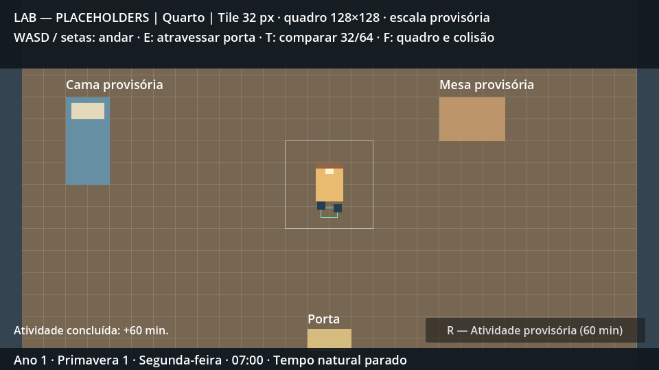

### Próxima tarefa

**P1-06 — sistema mínimo de diálogo/interação:** conversar sem consumir tempo por padrão. Sono e hobbies completos continuam nas tarefas correspondentes; escala, dia da semana inicial e localização en/es permanecem **[PENDENTE]**.

---

## P1-06 — diálogo/interação mínimos — 12/10/2026

**Critério de aceite:** conversar não consome tempo por padrão. Implementação limitada a falas lineares reutilizáveis, um NPC placeholder em cada mapa e integração com relógio/controles existentes.

### Arquivos e comportamento

- `scripts/dialogue/dialogue_data.gd` e `data/dialogues/lab_conversation.tres`: recurso com chave de identificação do interlocutor e sequência de chaves traduzíveis. Duas falas técnicas, sem determinar elenco ou fatos narrativos canônicos.
- `scripts/dialogue/dialogue_panel.gd` e `scenes/ui/dialogue_panel.tscn`: painel reutilizável com eventos `opened`/`closed`, avanço por E/Enter/botão e cancelamento por Esc/botão. Dados vazios são recusados antes de bloquear controles; uma conversa ativa não pode ser substituída.
- `scripts/world/dialogue_npc.gd` e `scenes/world/dialogue_npc.tscn`: quadrado azul provisório com área de proximidade e evento de diálogo. Instâncias em `room.tscn` e `street.tscn`; sem agenda, relações ou identidade de um NPC do elenco.
- `scripts/world/door.gd`/`door.tscn` e `scripts/lab/scale_lab.gd`: porta e NPC usam o grupo `interactables`, com alvo próximo selecionado pela menor distância dentro da área atual. Labels usam a chave da interação correspondente. A interação E continua funcionando nas portas.
- `scripts/player/player.gd`: controle de movimento pode ser bloqueado durante a conversa; velocidade é zerada e animação fica idle. Não pausa o SceneTree.
- `scenes/lab/scale_lab.tscn`, `localization/lab.csv`/`lab.pt_BR.translation`: painel, falas, botões e labels traduzíveis; README e este registro atualizados.
- `tests/dialogue_test.gd` e `docs/screenshots/dialogue_*.png`: testes e capturas reproduzíveis.

### Tempo e hipóteses técnicas

Durante a conversa, o laboratório desativa os ticks naturais sem alterar minutos nem a fração externa. Ao fechar, consulta a área atual: interior continua congelado; rua retoma. Nenhum caminho do diálogo chama `advance_minutes()`. A tecla que fecha o painel é consumida, evitando reabrir a conversa ou acionar uma porta no mesmo evento.

**[PROPOSTA]** Enquanto o painel está ativo, bloquear movimento, portas, atividade e controles de comparação do laboratório. Teclas E/Enter/Esc e caixa de falas sem retratos são UX técnica provisória. Ações programáticas de troca de mapa encerram a conversa com segurança e aplicam o estado do novo mapa. **[PENDENTE]** Conteúdo final, apresentação e escolhas/ramificações. Não foram adicionados managers globais, sistema de relações ou diário.

### Como executar e validar

Na Godot 4.5, F5. Caminhe até o quadrado azul à esquerda, espere aparecer “E — conversar” e use E. Avance com E/Enter/botão; feche com Esc/botão. Confira o horário antes/depois. Repita na rua: o rodapé indica tempo natural parado durante a conversa e volta a “Tempo externo” ao fechar.

Runner: `godot --headless --path . --script res://tests/dialogue_test.gd`. Para capturas, retire `--headless` e acrescente `-- --capture`. A opção `-- --realtime` mede 60 segundos reais; nesta etapa foi executada a medição curta padrão.

Godot `4.5.stable.official.876b29033`: importação/editor headless sem erros. **30 verificações de diálogo, zero falhas**, com proximidade física, propagação real de teclado, cliques na GUI, avanço/cancelamento, bloqueios, frações, troca programática de mapa, 32/64 e retomada. Medição final headless: **2,004 segundos reais de conversa na rua → +0 minutos**, com movimento bloqueado; ticks automáticos e movimento retomaram ao fechar. Execução renderizada: **32 verificações, zero falhas**, incluindo as duas capturas. Regressões: **60 do laboratório, 41 do relógio, 42 de interiores e 34 de atividades**, todas sem falhas.

Os cliques passaram na execução renderizada; para o headless, o runner injeta eventos de mouse em coordenadas locais do viewport, evitando a transformação de coordenadas da janela. Capturas renderizadas pela engine e inspecionadas visualmente. Logs locais em `test-results/dialogue-*.log`, ignorados pelo Git. Sem playtest humano.

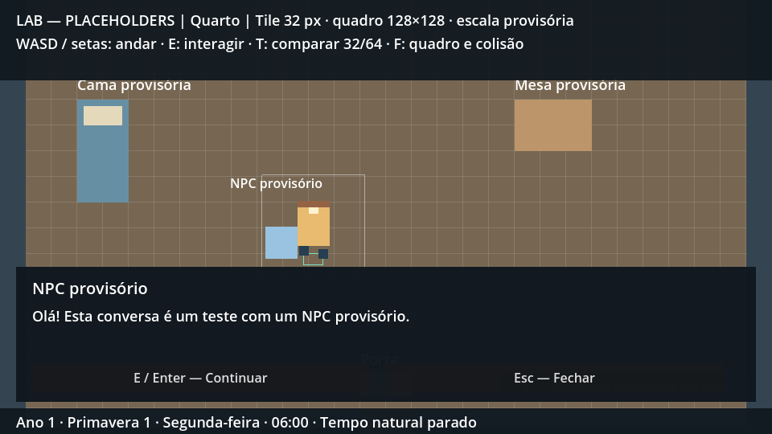

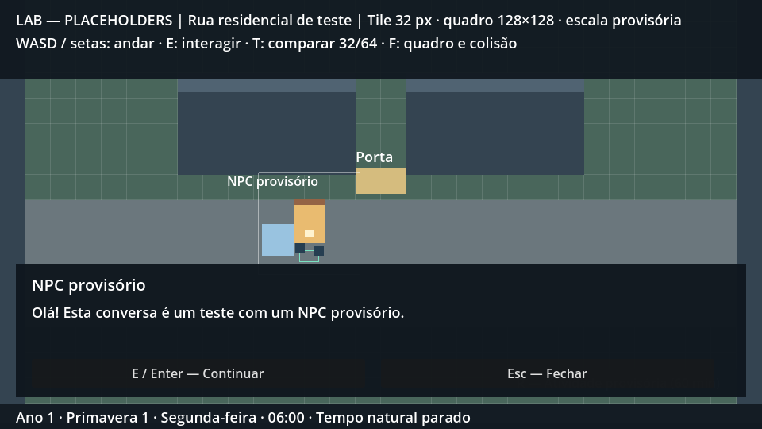

### Próxima tarefa

**P1-07 — sono, despertador e limite das 04h**, incluindo casa/fora de casa e despertar às 12h do mesmo dia quando fora. Permanecem as pendências de escala, dia da semana e localização, e a recusa provisória de ações da P1-05.

---

## P1-07 + P1-08 — sono, salvamentos e laboratórios — 12/10/2026

**Escopo autorizado pelo criador:** P1-07 (sono/despertador/04h), P1-08 (save manual e auto), desenvolvimento em Godot 4.7, tela cheia preservando escala, calendário clicável para debug, filtros sazonais e percurso/pátio grande para medir a caminhada. Esta autorização amplia a regra usual de uma tarefa por entrega; o mapa da faculdade continua laboratório, sem implementar antecipadamente aulas, notas ou agendas.

### Arquivos e integração

- `scripts/core/time_manager.gd`: sinal do limite obrigatório, bloqueio de novos avanços enquanto há escolha de sono e API específica de avanço durante sono. A passagem de meia-noite permanece normal. O limite é habilitado explicitamente pelo laboratório, mantendo o relógio reutilizável sem impor sozinho política de cena.
- `scripts/core/sleep_manager.gd`: solicitação/cancelamento voluntário, contexto obrigatório dentro/fora, cálculo do próximo despertador e despertar às 12h fora. Não define consequências de fadiga.
- `scripts/core/save_manager.gd`: esquema JSON versão 1, validação antes de carregar, slots manual/auto separados, escrita temporária e renomeação, preferência de autosave separada e desligada por padrão.
- `scripts/ui/lab_panel.gd`, `sleep_panel.gd`, `calendar_debug_panel.gd`: modais com containers/scroll, escolha de sono/save, alarme, calendário de 30 dias, ano/estação/horário, preferência de auto e botões para carregar os dois arquivos.
- `scripts/world/sleep_bed.gd`, `scenes/world/sleep_bed.tscn`, `room.tscn` e `lab_area.gd`: cama interativa em 32/64 e marcador seguro para despertar.
- `scripts/world/travel_lab_area.gd`, `scenes/world/route.tscn`, `campus.tscn`, `street.tscn` e `door.gd`: percurso sinalizado 12.800×1.600 e pátio 2.400×1.600, colisões, transições em ambos os sentidos e câmera com limites próprios de cada mapa. Medição de percurso fica no laboratório.
- `scripts/lab/scale_lab.gd`, `scenes/lab/scale_lab.tscn`, `scripts/dialogue/dialogue_panel.gd`, `project.godot`: integração, pausa por modal, retorno ao quarto, persistência, HUD responsivo, câmera zoom 1, fullscreen inicial sem stretch e filtro do mundo em camada abaixo da interface.
- `scripts/world/dialogue_npc.gd`: label curta de placeholder para evitar sobreposição com o personagem ao despertar.
- `localization/lab.csv` e recursos de tradução/importação: novas chaves pt_BR. en/es continuam pendentes.
- `tests/sleep_save_test.gd`, `travel_display_test.gd`, `dialogue_test.gd`: cobertura nova e adaptação do runner de GUI aos IDs de dispositivos/viewport da Godot 4.7. README, AGENTS e `godot_4_7_migration.md` registram engine atual, comandos e próxima tarefa.

### Regras e persistência

Ticks externos param exatamente às 04h, mesmo com delta grande, retornam ao quarto se necessário e abrem a oferta de manual/sem manual. Esc não cancela sono obrigatório; movimento, atividade e portas permanecem bloqueados até a escolha. Fora: 04h → 12h no mesmo dia (480 minutos). Em casa: próximo despertador. O sono avança minutos e dias intermediários na ordem, sem disparar novamente o limite durante a própria noite.

O manual captura o estado **pré-sono** e restaura a oferta ao carregar, inclusive o contexto de sono obrigatório fora de casa. O auto, se habilitado, guarda ao acordar e nas transições. Iniciar a cena ou carregar um slot não sobrescreve o auto existente. Não há carregamento automático na inicialização. Erro de manual mantém a escolha aberta; o jogador pode tentar novamente ou dormir sem salvar.

`user://saves/slot_01/manual.json`, `auto.json` e `user://settings.json`. Esquema guarda relógio/fração/origem da semana, nome/posição/área, despertador/contexto e tile; sistemas ainda inexistentes não são antecipados no save. Arquivo inválido/corrompido preserva o estado corrente. O limite de posição valida os limites do mapa, não reconstitui toda a colisão de um arquivo editado manualmente. A renomeação é feita na mesma pasta; não foi simulado corte de energia nem falha física de disco.

### Hipóteses técnicas e pendências

**[PROPOSTA]** Alarme inicial 06h; alarme igual ao instante de deitar vale para o próximo dia. Fração natural reiniciada ao acordar, atraso excedente do frame interrompido às 04h descartado. Origem inicial da semana continua provisória/configurável. O campo de nome no debug testa persistência; não substitui o futuro fluxo de nova partida.

A recusa prévia de atividades que terminariam às 04h ou depois permanece da P1-05. **[PENDENTE]** UX definitiva para essas ações, consequências balanceadas de sono curto e caso de alarme exatamente às 04h (atualmente desperta no horário selecionado). Sem barra de energia ou crafting.

O calendário é debug de avanço: salta diretamente para a data/hora, sem simular noites/agenda/eventos intermediários. Destino exatamente às 04h dispara o sono obrigatório. Datas anteriores ficam desabilitadas. Os dias da semana seguem o contador absoluto, sem reiniciar em cada estação.

Filtros técnicos suaves: primavera rosa, verão azul, outono laranja, inverno branco; não definem direção de arte nem clima. Dimensões do percurso/pátio, velocidade e placas são dados de laboratório, não cânone geográfico. Contador de segundos inclui pausas durante a viagem; minutos de jogo seguem as regras de pausa. Reentrar pelo lado residencial reinicia a medição.

### Validação executada

Godot **4.7.2.stable.official.ed1daf0bf**, importação/editor headless sem erros. Documentação oficial das migrações 4.5→4.6→4.7 consultada; mudanças aplicáveis registradas em [godot_4_7_migration.md](godot_4_7_migration.md).

| Runner | Verificações | Resultado |
|---|---:|---|
| Sono/save | 51 | zero falhas |
| Laboratório | 60 | zero falhas |
| Relógio | 41 | zero falhas |
| Interiores | 42 | zero falhas |
| Atividades | 34 | zero falhas |
| Diálogo | 30 | zero falhas |
| Exibição/percurso padrão | 12 | zero falhas |

Total dos sete runners padrão: **270 verificações**. Sono/save usa interações reais de teclado e cliques de GUI, camas 32/64, sono obrigatório/voluntário, eventos intermediários, save pré-sono, retomar contexto obrigatório, preferências e arquivos independentes, arquivo inválido/corrompido, calendário/alinhamento da semana e filtros. Testes escrevem somente em diretórios isolados de `user://test_runs/`.

Ensaio adicional `travel_display_test.gd -- --walk`: **14 verificações, zero falhas**; percurso completo com física de colisão e ticks naturais, **12.351 px em 68,717 segundos reais → +68 minutos**. Porta distante alcançada caminhando e entrada/saída do pátio corretas. Essa variante inclui as verificações padrão; não somar suas contagens como testes independentes.

Execução renderizada `-- --capture`: **19 verificações, zero falhas**, sete PNGs gerados pela engine e inspecionados visualmente. Escala/HUD verificados em 960×540, 1366×768 e 1920×1080; viewport de tela cheia capturado nesta máquina: 1366×767. Corpo do protagonista conserva 40×56 pixels. Não foi realizado playtest humano nem conferência de todos os monitores/DPIs. Regressões usaram esperas reais curtas; não repetiram os ensaios históricos de 60 segundos. Logs locais ignorados pelo Git.

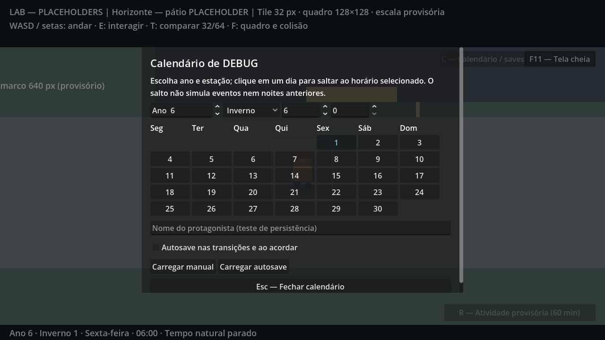

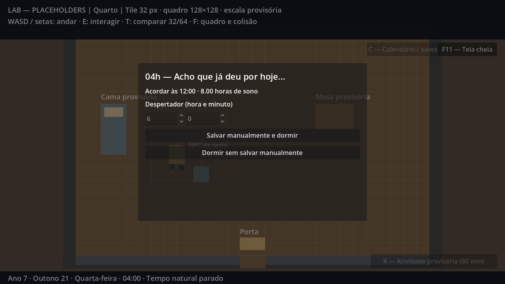

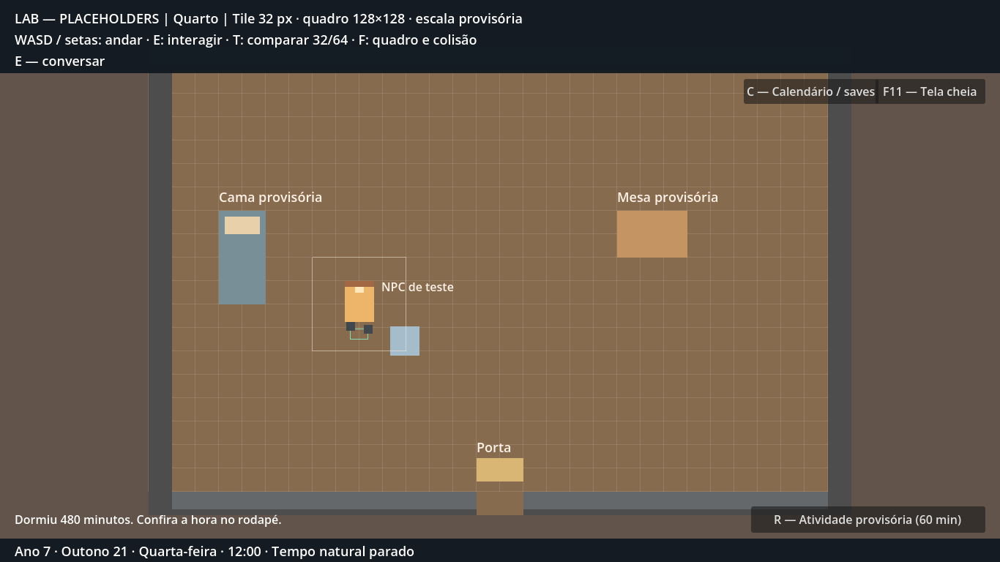

Filtros no mesmo enquadramento do pátio: [primavera](screenshots/season_0.png), [verão](screenshots/season_1.png), [outono](screenshots/season_2.png), [inverno](screenshots/season_3.png).

### Próxima tarefa

**P2-01 — trajeto residencial → Horizonte sinalizado**, consolidando o protótipo atual para chegar a pé à aula das 09h em ritmo viável. Nenhuma dimensão do laboratório foi promovida a cânone. P0-03/Drowned, origem da semana, conteúdo final, en/es e balanceamento permanecem pendentes.

---

## P2-01 — trajeto residencial → Horizonte sinalizado — 13/10/2026

**Critério:** chegar a pé para a referência de aula das 09h em ritmo viável. Esta entrega consolida o mapa grande solicitado na P1, preservando dimensões, velocidade e escala. Não implementa a sala de aula (P2-02), grade/frequência (P2-03), professor ou novos NPCs.

### Arquivos e comportamento

- `scripts/world/wayfinding_sign.gd` e `scenes/world/wayfinding_sign.tscn`: placa reutilizável com duas chaves traduzíveis, sem colisão de bloqueio. Instâncias na rua e no pátio; dezenove placas a cada 640 px no percurso, orientando Horizonte à direita e bairro à esquerda.
- `scripts/world/travel_lab_area.gd`: substitui a sinalização antiga desenhada diretamente pelo componente reutilizável. Rebuild de tiles não duplica placas. Dimensões 12.800×1.600 e 2.400×1.600 preservadas.
- `scripts/world/journey_destination.gd` e `scenes/world/journey_destination.tscn`: destino Area2D, evento de chegada apenas para o jogador e retângulo placeholder em frente à fachada, posição (1504,680). Não entra no prédio nem bloqueia a exploração.
- `scripts/world/walking_journey.gd`: medição diagnóstica desacoplada de cenas, com origem, segundos monotônicos, minutos do mundo, horário de chegada e margem até as 09h do dia da saída. Resultado estruturado em IDs/valores, traduzido apenas ao apresentar.
- `scripts/lab/scale_lab.gd`: começa ao sair do quarto, continua pela rua/percurso/pátio e termina ao tocar o destino. Entrada direta no percurso inicia ensaio identificado como parcial. Reentrar no destino não sobrescreve o resultado. Voltar ao quarto, saltar calendário, carregar ou usar T reinicia a medição; a medição não é persistida como estado de gameplay.
- `scenes/world/street.tscn` e `campus.tscn`: direções de ida/volta e marcador de chegada; caminhos existentes permanecem acessíveis em ambos os sentidos.
- `localization/lab.csv` e tradução pt_BR: novos textos por chave. `tests/signposted_journey_test.gd`: ida inteira e volta usando movimento/física e teclado E reais, pontualidade, atraso, resets, saves e escala. `tests/travel_display_test.gd`: entrar no pátio agora mantém a medição ativa até o prédio.
- README/AGENTS atualizados com controles, escopo e próxima tarefa. Capturas `docs/screenshots/signposted_*.png`. Fonte do cabeçalho reduzida para 16 em larguras abaixo de 1100, evitando quebra sobre os controles em 960×540; câmera e personagem continuam em escala 1.

### Como rodar

Godot 4.7, F5. Saia do quarto com E, siga a placa à direita da rua e use E na passagem. Continue para a direita no percurso, entre no pátio com E, siga à direita e depois para cima até o retângulo em frente à fachada. Confira no HUD o horário e a margem até as 09h. Volte para a esquerda seguindo as placas do bairro e, na rua, siga a indicação de casa e use E na porta.

Runner: `godot --headless --path . --script res://tests/signposted_journey_test.gd`. Padrão acelera relógio e física com `Engine.time_scale = 8` para repetir os trajetos. Acrescente `-- --walk` para a primeira ida na proporção real de produção; retorno e saída tardia continuam acelerados. Para cinco capturas, retire `--headless` e acrescente `-- --walk --capture`.

### Validações e limites

Godot **4.7.2.stable.official.ed1daf0bf**. Runner padrão: **59 verificações, zero falhas**, incluindo caminhada de ida/volta sem teletransportes, overlap físico nas quatro passagens, chegada antes das 09h, saída tardia sem bloqueios, alinhamento das placas, marcador do prédio, não duplicação do resultado, reinício por debug/load/T, tiles e saves em diretório isolado. O runner só reposiciona o personagem ao preparar capturas de enquadramento, após concluir a medição.

Regressões executadas nesta entrega: laboratório **60**, diálogo **30**, sono/save **51** e exibição/percurso **12**, todas sem falhas (**153 verificações**). O teste de exibição foi repetido depois do ajuste de fonte. As regressões históricas de relógio/atividades/interiores não foram repetidas porque seus módulos não foram alterados; resultados anteriores permanecem no registro da P1. Importação final e ensaio renderizado registrados abaixo.

**[PROPOSTA]** Placas a cada 640 px, seus tamanhos/posições, corredor reto e marcador são layout técnico para testar caminhada. Não promovem o mapa a cânone nem definem arte final. O retângulo de chegada termina o teste ao tocar sua área, sem exigir interação extra.

**[PENDENTE]** Layout final da cidade/campus, tile definitivo, arte de placas e possibilidade futura de transporte. Segundos decorridos incluem pausas e hesitações; minutos seguem as regras de relógio. Medição até as 09h é referência diária de laboratório, não afirma que há aula em fim de semana/férias nem registra presença/falta. O jogador pode chegar tarde e continuar explorando. Escala 128×128/zoom 1 e regras de sono/save preservadas; Drowned não foi alterado.

Importação/editor headless final sem erros. Ensaio renderizado na proporção real: **79,129 segundos da saída de casa até o ponto de entrada**, avanço de **79 minutos**, chegada **07:19**, **101 minutos de margem até 09h**. Distância percorrida pelo runner desde o spawn inicial do quarto: 14.300,4 px (inclui o trecho interior anterior ao início da medição externa). Cinco capturas e verificação adicional do cabeçalho 960×540: **65 verificações, zero falhas**. São variantes do mesmo runner, não somar a contagem de 65 à de 59 como testes independentes.

As imagens finais foram inspecionadas: cabeçalho em três linhas sem sobrepor os botões em 960×540, placa da entrada acima do rodapé, label do destino acima do personagem, placas de ida/volta legíveis. O ensaio real foi repetido após corrigir a sobreposição do cabeçalho e a posição da placa encontradas nas primeiras capturas. Sem playtest humano. Logs em `test-results/journey-*.log`, ignorados pelo Git. Nos outros trajetos do runner, a aceleração é somente do teste e é restaurada antes de encerrar; produção mantém a proporção canônica.

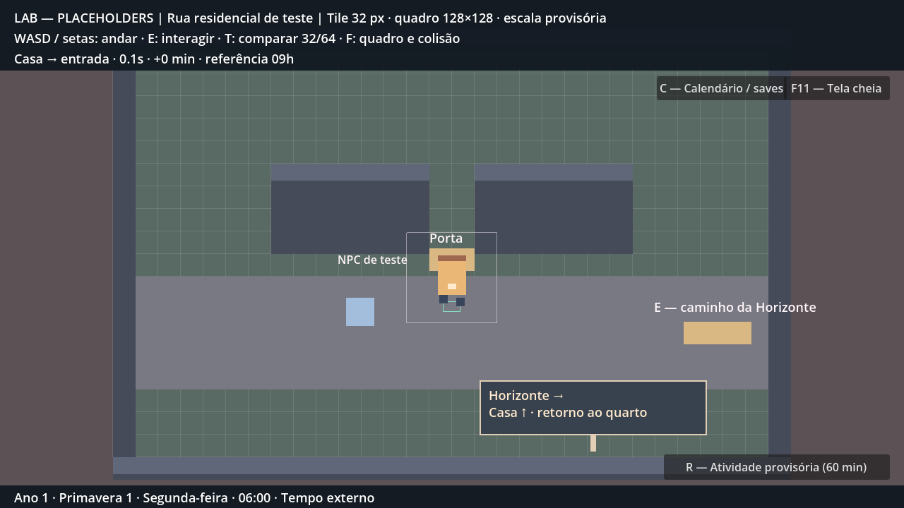

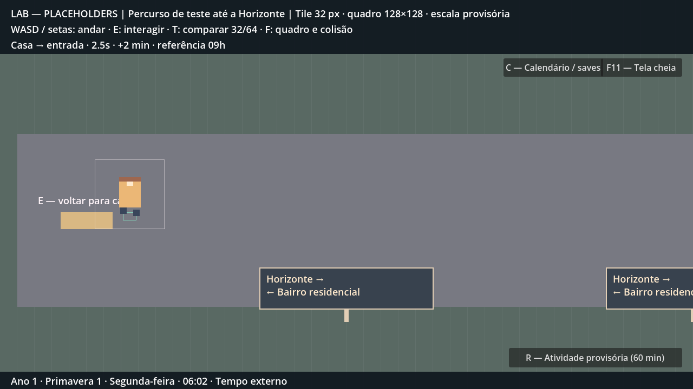

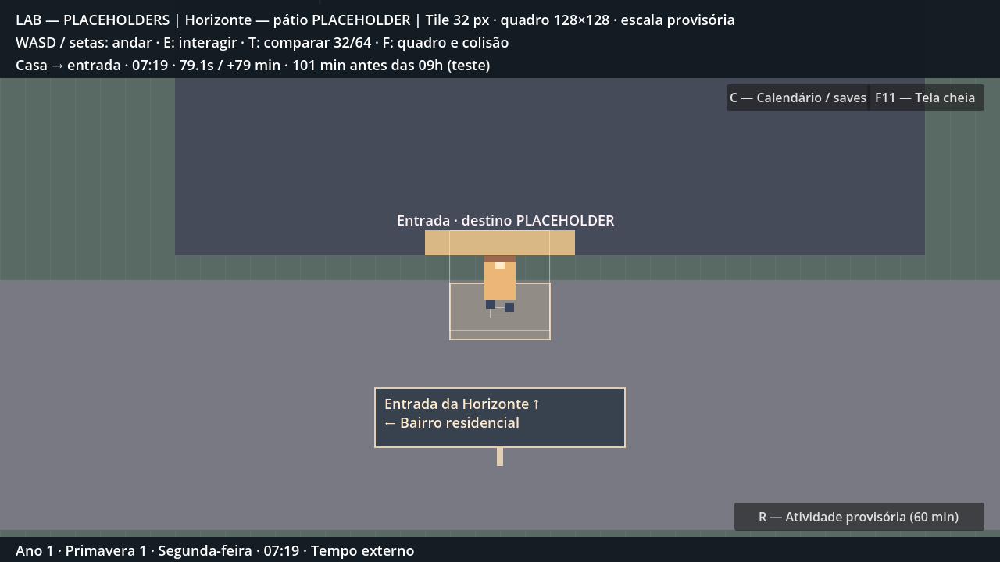

[Chegada em 960×540](screenshots/signposted_arrival_960.png) · [Placas no pátio](screenshots/signposted_campus.png)

### Próxima tarefa

**P2-02 — cena da universidade e sala de aula:** entrar, explorar, conversar e acessar o ponto de aula. Agenda acadêmica/frequência continua separada na P2-03. Não antecipar avaliação, elenco completo ou outros mapas nesta próxima etapa.

---

## P2-02 — universidade e esqueleto urbano — 13/10/2026

**Escopo autorizado:** próxima tarefa (universidade/sala) e reformulação explícita do mapeamento pelo criador: ruas curvas, subidas/descidas, acessos futuros, menor repetição de placas e fade-out/in. A geometria anterior da P2-01 foi substituída; suas capturas/medições permanecem registro histórico, não a planta vigente.

### Entrega e arquivos

- `data/world/regions.json`: bairro 3200×2400, via do rio 6000×3600, campus 3200×2600, hall 1600×1100 e sala 1400×1000. Quarto 960×640 preservado. Dados incluem vias principais/secundárias, curvas, lotes, praças, patamares/taludes/rampas, água/ponte, decoração, labels traduzíveis, portas/spawns, guia, destino e ponto de aula.
- `scripts/world/world_layouts.gd`: leitura/conversão central dos dados e curvas suaves. Os mesmos limites são consultados pelos saves. `city_area.gd`: desenho geométrico, colisões e instanciamento de componentes existentes. As cenas de rua/percurso/campus escolhem a região; novas cenas de hall/sala fazem o mesmo. O antigo `travel_lab_area.gd` foi removido.
- Bairro com circuito em volta da praça; campus com circuito de circulação. Dez ruas secundárias/alternativas somadas nas áreas externas, cada uma verificada fisicamente. Lotes reservados não ativam lojas/hobbies/futuras regiões.
- Placas nos cruzamentos (duas por área externa, uma no hall), sem sequência repetida por distância. Sinalização e portas continuam componentes reutilizáveis. Edifícios de tamanhos variados, sombras simples, árvores geométricas, praças e formas de terreno são placeholders, sem novos assets externos.
- `scripts/ui/scene_fade.gd`: fade-out, frame preto, troca de mapa, atualização da câmera e fade-in. `scripts/lab/scale_lab.gd`: valida destino antes do fade, bloqueia interações/movimento/ticks, preserva fração temporal e integra portas, carregamento e retorno do sono obrigatório. `change_area()` permanece operação imediata interna para inicialização/testes; interação de jogador usa o fluxo animado.
- `data/dialogues/university_guide.tres` e `lesson_placeholder.tres`: guia técnico e acesso à sala de História por chaves. `interaction_point.gd`/`.tscn`: ponto de aula que abre diálogo placeholder. `dialogue_npc.gd` aceita uma chave de marker para identificar o guia, sem definir professor/elenco final. Hall/sala são interiores navegáveis com relógio natural congelado.
- `scripts/core/save_manager.gd`: esquema 2 aceita novos interiores/limites. Migração valida o esquema 1 com limites antigos e reposiciona saves externos na entrada segura da mesma região; quarto conserva posição. Mantém nome, minutos/fração, origem da semana, alarme/contexto e tile. Não regrava o arquivo original durante carga. Novos JSONs usam precisão completa para frações.
- `tests/city_university_test.gd`: runner urbano/interiores/fade/migração. `signposted_journey_test.gd` passa a alias de compatibilidade do mesmo runner (não contar como suíte independente). `travel_display_test.gd` adapta limites e espera o fade; caminhada completa fica no novo runner. Demais runners aguardam transições quando aplicável e usam diretórios isolados, inclusive os testes legados, para proteger slots da partida.
- `localization/lab.csv` e tradução pt_BR, README/AGENTS e [city_layout.md](city_layout.md): instruções, hipóteses, referências e imagens. Sem mudanças no GDD histórico ou Drowned.

### Uso e limites

F5 na Godot 4.7. E sai do quarto; siga as ruas da praça até a saída ao sul/leste. Na via do rio, atravesse a ponte, siga a rampa ao norte e a rua sinuosa até o campus no nordeste. Pelo pátio/rampa chegue à fachada e use E para entrar no hall. Converse com o guia, siga o corredor à direita/acima e use E para entrar na História; o corredor central chega ao ponto de aula. E abre o diálogo provisório. Volte pelas mesmas passagens ou explore os circuitos/ramais.

**[PROPOSTA]** Distribuição de lotes/ruas e suas dimensões, posição da escola/comércio/hobbies, ponte/patamares, árvores e decoração são layout de teste. As referências solicitadas foram interpretadas para Fliegen; não se copiou planta/asset de outro jogo. Detalhes e fontes em `city_layout.md`.

Desnível é topografia 2D: terreno em patamares, taludes sólidos, passagens por rampa/escadaria. Não há eixo Z, pulo ou penalidade de velocidade/energia. Árvores são decoração sem colisão nesta fase. Terreno livre pode ser atravessado; somente edifícios, água/taludes e limites bloqueiam. As ruas secundárias terminam em reservas, sem novos mapas/sistemas completos. Grade/presença/notas não são implementadas; o ponto de aula indica conteúdo futuro. A referência das 09h continua diagnóstica, sem afirmar aula em fim de semana/férias.

Save antigo externo muda de posição pela reforma de geometria e informa a migração; nenhum arquivo é sobrescrito só ao carregar. O esquema atual guarda posição exata dentro dos limites, sem reconstruir colisão de arquivos editados manualmente. Precisão limitada já gravada por JSONs antigos não pode ser recuperada; a migração verifica fração com tolerância de 1e-6, e os novos saves verificam round-trip exato de `0.1234567890123456`. Slot manual/auto e preferência continuam independentes.

### Validações executadas

Godot **4.7.2.stable.official.ed1daf0bf**, importação/editor headless final sem erros. Os oito runners padrão passaram:

| Runner | Verificações | Resultado |
|---|---:|---|
| Cidade/universidade | 90 | zero falhas |
| Laboratório/movimento | 60 | zero falhas |
| Relógio | 41 | zero falhas |
| Interiores | 42 | zero falhas |
| Atividades | 34 | zero falhas |
| Diálogo | 30 | zero falhas |
| Sono/save | 51 | zero falhas |
| Exibição/transições | 12 | zero falhas |

**360 verificações padrão**, sem somar o alias. Novo runner percorre vias com física de colisão e E real; verifica ida/volta, barreiras de rio/talude fora das passagens, dez ramais/circuitos, fade por fase, clock/fração congelados durante fade, uma área ativa, guia, exploração e ponto de aula, save de interior, migração sem regravação, 04h na universidade/retorno às 12h e autosave desligado respeitado. A medição é feita antes dos fixtures de colisão/ramais; não há teletransporte no meio da ida/volta.

Ensaio renderizado `-- --walk --capture`: **100 verificações, zero falhas**, dez PNGs da engine inspecionados. Primeira ida na proporção real: **106,445 segundos**, **+105 minutos**, chegada **07:45**, **75 minutos de margem até 09h**. Segundos incluem fades e breves operações de captura; o relógio pausa durante fade. Retorno/fixtures acelerados com `Engine.time_scale = 6`, restaurado ao encerrar; o ensaio padrão acelerado não fornece medição real 1:1. A variante renderizada inclui o conjunto base de 90 e não deve ser somada como suíte independente.

As visões gerais usam câmera de inspeção apenas no teste. Gameplay conserva câmera zoom 1, corpo 40×56 e frame 128×128. Capturas mostram curvas, circuitos, ponte/rampa, interior/sala e frame completamente preto do fade. Regressão de exibição confere escala/HUD em 960×540, 1366×768 e 1920×1080. Não houve playtest humano nem simulação de corte de energia/falha física de disco. Logs `test-results/city-*.log` ignorados pelo Git; todas as suítes escrevem somente em `user://test_runs/`.

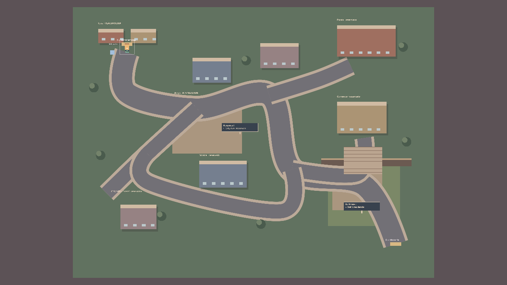

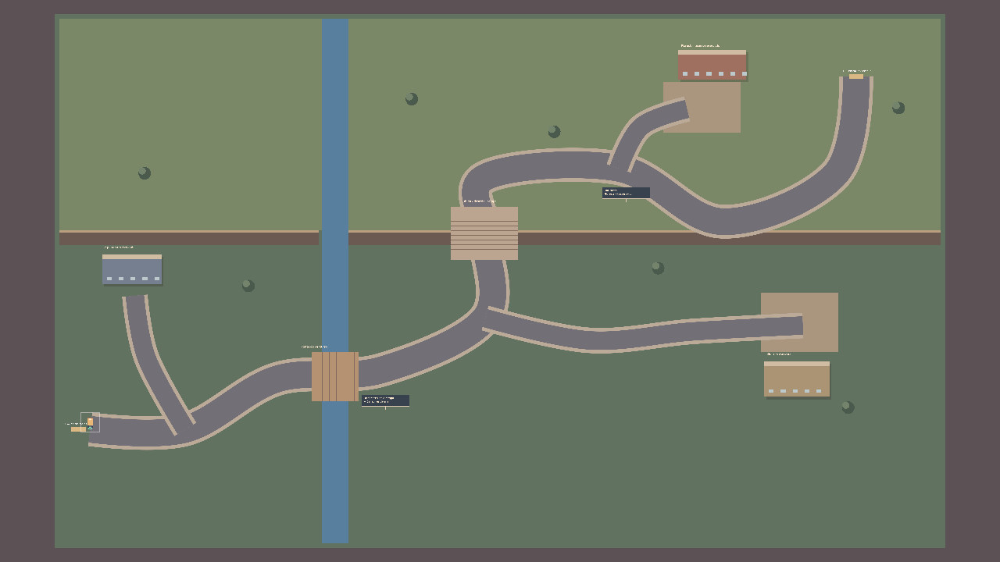

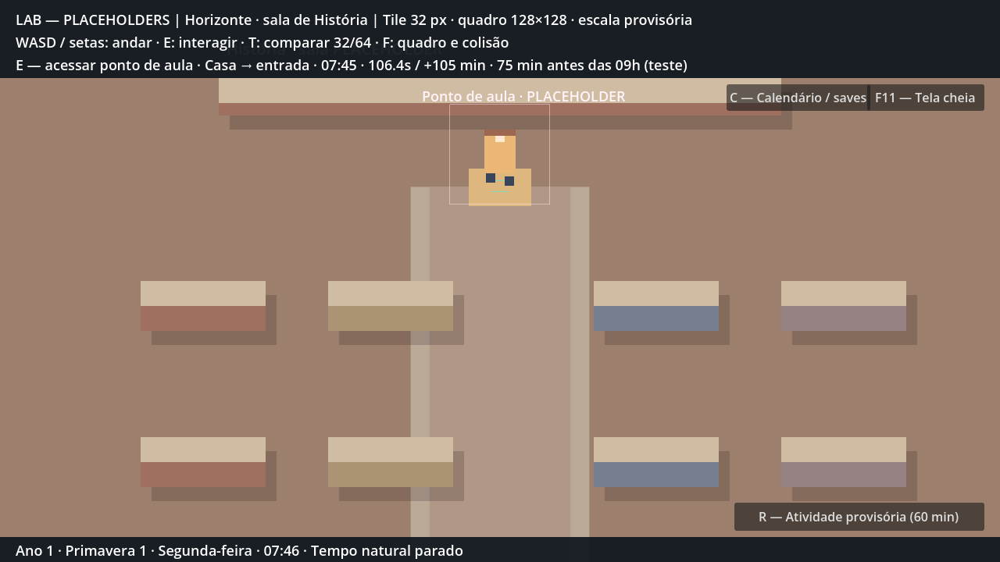

Demais imagens e referências em [city_layout.md](city_layout.md).

### Próxima tarefa

**P2-03 — agenda acadêmica mínima manhã/tarde**, avanço temporal de aulas e registro de presença/falta. Horários de encerramento matutino/almoço/tarde continuam provisórios no GDD. Tile/arte/layout final, conteúdo acadêmico e NPCs definitivos, transporte, origem da semana e en/es permanecem pendentes. Não implementar outras fases só porque existem reservas no mapa.
