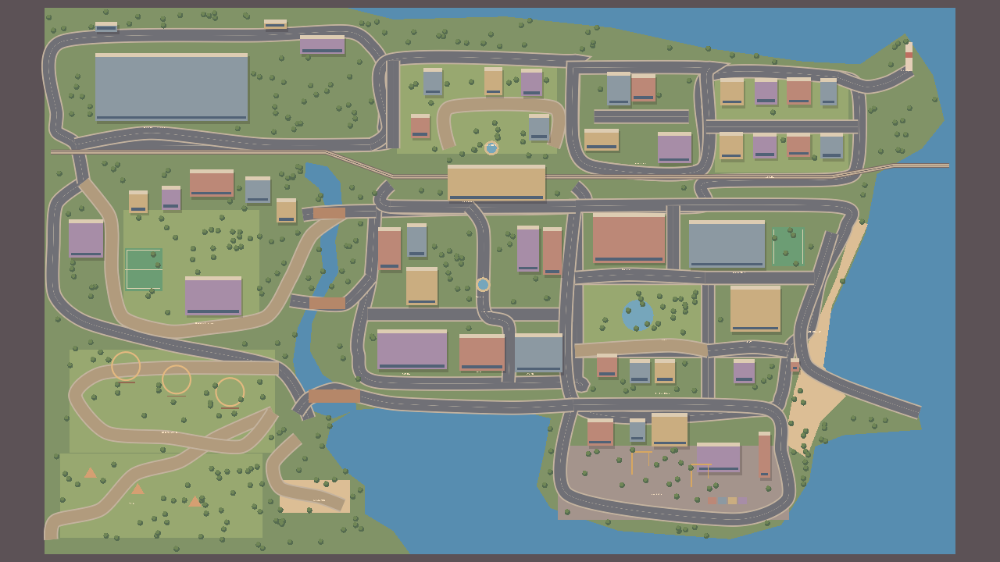
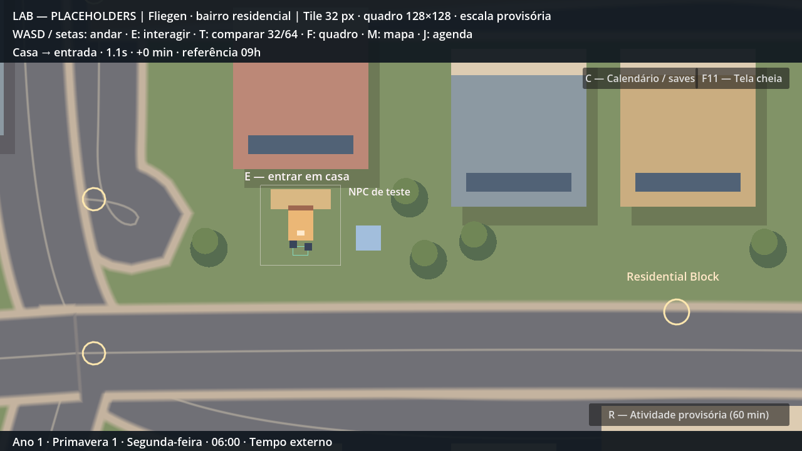
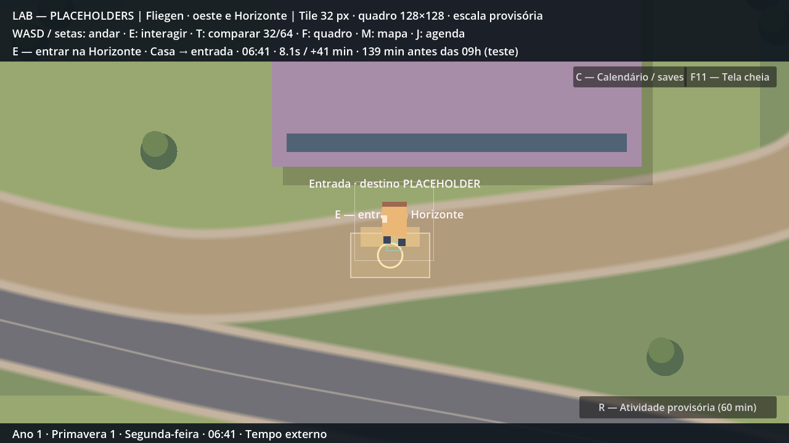
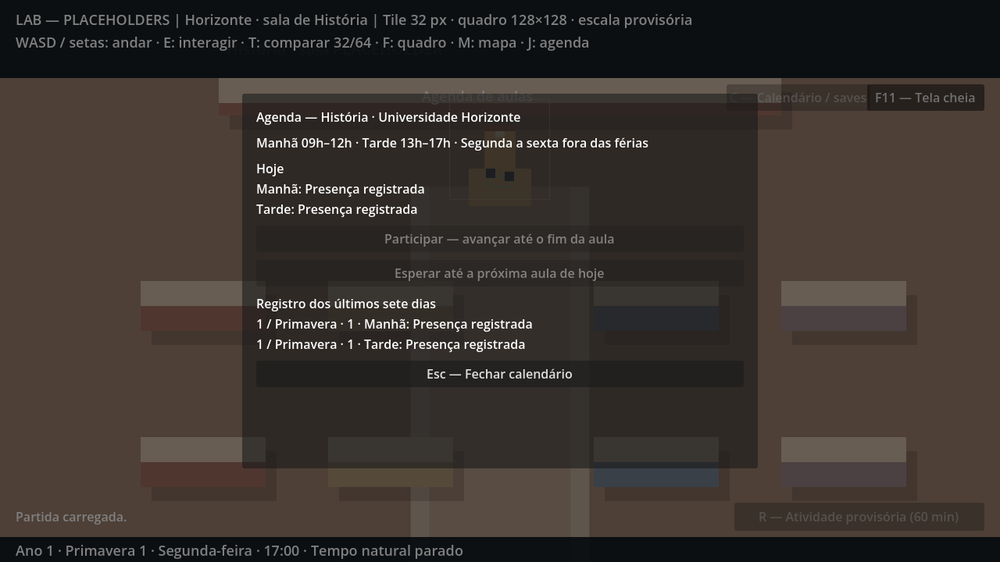

# Cidade de referência e agenda — P2-03

## Autorização e escala

Em 15/10/2026 o criador pediu substituir a planta anterior pela imagem anexada, utilizando seus pontos de interesse e estradas. Esclareceu: **reconstruir ampliado, preservando proporções e escala do personagem**. Também autorizou **09h–12h e 13h–17h nesta etapa**. Essas decisões não reescrevem as referências históricas do GDD.

**[HIPÓTESE TÉCNICA]** Fator uniforme 6: cada coordenada da imagem 1620×971 equivale a seis pixels do mundo, formando 9720×5826. Não há escala diferente entre eixos. Frame 128×128, corpo 40×56, pés 24×14, velocidade 180 px/s e câmera zoom 1 permanecem iguais. Fullscreen aumenta a área visível. Os recortes se sobrepõem nas passagens para evitar colocar a saída no limite físico do mapa.

| Setor / ID técnico | Recorte da referência | Dimensões jogáveis |
|---|---|---|
| Oeste / `campus` | x 0–610; y 0–971 | 3660×5826 |
| Centro / `route` | x 560–970; y 0–971 | 2460×5826 |
| Leste / `street` | x 920–1620; y 0–971 | 4200×5826 |

A casa inicial fica no Residential Block. Universidade, supermercado, parque, camping e praia escondida ficam no setor oeste. Centro, estação, Maple Heights e rua comercial ficam no central. O restante fica no leste. Os IDs antigos foram mantidos para migração; seus títulos atuais refletem a nova planta.

## Reconstrução

`reference_city.json` contém os traçados anotados sobre a imagem: **33 trechos de ruas, caminhos e pontes, mais a ferrovia**, costa/rio e fachadas. São desenhados como geometria com curvas, calçadas simples e variação entre avenida e caminho. Prédios têm pegadas de colisão; água/costa usam células pequenas unidas horizontalmente, com corredores transitáveis nas pontes e no píer. Árvores, campos, tendas, roda de parque, fontes, farol e guindastes são formas decorativas, sem atividades próprias.

As posições e proporções gerais vêm da referência; fachadas, árvores e detalhes são aproximações para circulação, sem arte final. Não há navegação ferroviária, barcos, física Z ou simulação de relevo. O terreno permite circulação livre fora dos obstáculos; vegetação decorativa não bloqueia. As larguras de passagens incluem uma margem para os pés do personagem. Água e prédios bloqueiam os atalhos correspondentes. A praia escondida e o camping podem ser explorados sem ativar minigames/hobbies.

A imagem original fornecida pelo criador está preservada em `assets/world/fliegen_reference.png`, **usada apenas no painel M**, com ponto vermelho da posição atual. O cenário jogável é redesenhado com formas, sem a imagem ampliada no chão e sem placas brancas gigantes. A vista geral abaixo usa zoom de inspeção exclusivamente no runner.

## Todos os locais

| Local da referência | Setor | Coordenada de acesso na imagem |
|---|---|---|
| Supermercado Atacadista | Oeste | 190, 222 |
| Maple Heights | Centro | 796, 253 |
| Comércio Norte | Leste | 1060, 286 |
| Sunnyview | Leste | 1295, 310 |
| Lighthouse Point | Leste | 1530, 120 |
| Central Station | Centro | 755, 354 |
| Universidade Horizonte | Oeste | 282, 570 |
| Downtown | Centro | 780, 523 |
| City Hospital | Leste | 1040, 474 |
| Eastwood School | Leste | 1235, 480 |
| Willow Park | Leste | 1110, 600 |
| Library | Leste | 1260, 603 |
| Seabreeze Beach | Leste | 1370, 585 |
| Market Street | Centro | 790, 550 |
| Café Row | Centro | 650, 660 |
| Arcade | Centro | 780, 657 |
| Live Music | Centro | 870, 660 |
| Residential Block | Leste | 1100, 695 |
| Harbor District | Leste | 1090, 874 |
| Parque de Diversões | Oeste | 220, 764 |
| Camping | Oeste | 160, 890 |
| Praia Escondida | Oeste | 490, 885 |

Cada local tem identificação por chave traduzível e ponto externo de consulta. A universidade também possui porta, hall e sala existentes. Os demais interiores e sistemas não são antecipados. O ponto de consulta não implica descobrir relações/segredos de NPCs.

## Passagens e orientação

**14 ligações reversíveis entre setores**: as duas principais e doze alternativas, cada uma com spawn nos dois lados. Ao chegar perto, E continua na próxima região com fade-out, troca sob preto e fade-in. Passagens secundárias usam um círculo discreto; a indicação aparece no HUD ao aproximar. Sem fileiras de placas repetidas. As colisões de borda impedem sair do recorte sem transição.

A ida principal parte do Residential Block, sobe pela avenida, cruza para a rua da estação, segue a oeste e atravessa a ponte do rio até a entrada da Horizonte. M orienta a posição na referência. Caminhada chega antes das 09h quando parte às 06h; valores medidos constam na última seção de `decisions.md`. O medidor é diagnóstico, distinto do registro acadêmico: chegar ao campus não atribui presença.

## Agenda e registro

Horários em `data/schedules/academic.json`. `AcademicSchedule` recebe eventos do relógio; não depende da cena ou de NPC específico. Em cada dia letivo, há manhã e tarde. Sábado/domingo e férias (verão 1–7, inverno 24–30) não criam faltas. Isso é o filtro mínimo necessário para a agenda; não antecipa os demais sistemas sazonais da P3.

E no ponto de aula abre a agenda, ou J consulta de qualquer lugar. Participar/esperar exige estar na sala, e o controlador revalida essa condição. Chegar cedo oferece espera explícita, pois o interior congela o relógio. Durante uma aula, não é possível usar o botão de espera para pulá-la. Participar avança minuto por minuto até o fim do turno; entre 12h e 13h, esperar avança ao turno da tarde. Não há espera automática até outro dia nem passagem pelo limite das 04h.

**[HIPÓTESE TÉCNICA]** É permitido participar chegando depois do início e antes do término. O instante de entrada fica salvo; penalidade por atraso, frequência parcial e notas são **[PENDENTE]**. Entrar no edifício, conversar ou ficar parado na sala não registra participação. A interface mostra a situação de hoje e os últimos sete dias, com data/estação/ano e cada turno.

O histórico guarda o início do acompanhamento, o instante avaliado e um dicionário de presenças por dia/turno. Falta é o turno letivo encerrado dentro do intervalo acompanhado sem presença. Esse intervalo também é persistido, permitindo recuperar faltas sem materializar milhões de linhas durante saltos para o ano 9999. Sono e avanço natural emitem eventos; o debug reconcilia o intervalo diretamente. Carregamento restaura relógio e intervalo juntos antes de retomar a avaliação. Não há retroatividade anterior ao início do registro de um save migrado.

## Persistência e limites

Esquema 3 lê arquivos 1/2 com seus limites históricos, desloca somente os exteriores e inicializa o registro no horário salvo. Os originais não são regravados ao carregar. Estado inválido é recusado antes de alterar a partida; presenças exigem dia letivo e entrada dentro do turno, com término já avaliado. Manual antes do sono e auto opcional continuam separados. Auto também pode gravar após esperar/participar. Preferências não fazem parte do snapshot.

Textos novos em pt_BR por chaves, prontos para futura tradução en/es. A referência contém nomes em inglês, mantidos como fornecidos sem transformá-los em cânone definitivo. A planta é editável nos dados. Pontos de entrada/fachadas são aproximações manuais; não existe extração automática pixel a pixel nem arte/tilemap final. Drowned não foi acessado ou modificado. Próxima tarefa: P2-04, professor e diálogo da primeira aula.
